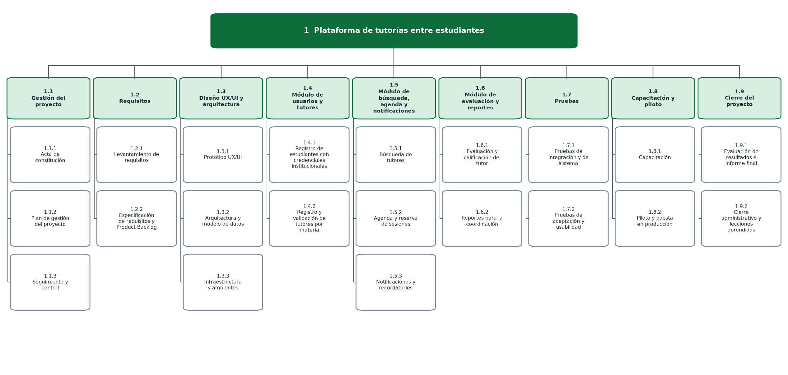

# 3. Estructura de desglose del trabajo (EDT / WBS)

*Plataforma de tutorías entre estudiantes (TutorFISC) · Gerencia de Proyectos Informáticos (8469) · 1LS241*

La EDT se organiza por entregables en tres niveles: el proyecto (nivel 1), 9 entregables (nivel 2) y 21 paquetes de trabajo (nivel 3). Cumple la regla del 100 %: cada elemento del alcance incluido en el Acta está representado en al menos un paquete y no existe trabajo fuera del alcance.

## EDT codificada

| Código | Nivel | Nombre del elemento | Tipo |
|---|---|---|---|
| 1 | 1 | Plataforma de tutorías entre estudiantes | Proyecto |
| 1.1 | 2 | Gestión del proyecto | Entregable |
| 1.1.1 | 3 | Acta de constitución | Paquete de trabajo |
| 1.1.2 | 3 | Plan de gestión del proyecto | Paquete de trabajo |
| 1.1.3 | 3 | Seguimiento y control | Paquete de trabajo |
| 1.2 | 2 | Requisitos | Entregable |
| 1.2.1 | 3 | Levantamiento de requisitos | Paquete de trabajo |
| 1.2.2 | 3 | Especificación de requisitos y Product Backlog | Paquete de trabajo |
| 1.3 | 2 | Diseño UX/UI y arquitectura | Entregable |
| 1.3.1 | 3 | Prototipo UX/UI | Paquete de trabajo |
| 1.3.2 | 3 | Arquitectura y modelo de datos | Paquete de trabajo |
| 1.3.3 | 3 | Infraestructura y ambientes | Paquete de trabajo |
| 1.4 | 2 | Módulo de usuarios y tutores | Entregable |
| 1.4.1 | 3 | Registro de estudiantes con credenciales institucionales | Paquete de trabajo |
| 1.4.2 | 3 | Registro y validación de tutores por materia | Paquete de trabajo |
| 1.5 | 2 | Módulo de búsqueda, agenda y notificaciones | Entregable |
| 1.5.1 | 3 | Búsqueda de tutores | Paquete de trabajo |
| 1.5.2 | 3 | Agenda y reserva de sesiones | Paquete de trabajo |
| 1.5.3 | 3 | Notificaciones y recordatorios | Paquete de trabajo |
| 1.6 | 2 | Módulo de evaluación y reportes | Entregable |
| 1.6.1 | 3 | Evaluación y calificación del tutor | Paquete de trabajo |
| 1.6.2 | 3 | Reportes para la coordinación | Paquete de trabajo |
| 1.7 | 2 | Pruebas | Entregable |
| 1.7.1 | 3 | Pruebas de integración y de sistema | Paquete de trabajo |
| 1.7.2 | 3 | Pruebas de aceptación y usabilidad | Paquete de trabajo |
| 1.8 | 2 | Capacitación y piloto | Entregable |
| 1.8.1 | 3 | Capacitación | Paquete de trabajo |
| 1.8.2 | 3 | Piloto y puesta en producción | Paquete de trabajo |
| 1.9 | 2 | Cierre del proyecto | Entregable |
| 1.9.1 | 3 | Evaluación de resultados e informe final | Paquete de trabajo |
| 1.9.2 | 3 | Cierre administrativo y lecciones aprendidas | Paquete de trabajo |

## EDT en forma de árbol



*Figura 1. EDT del proyecto en forma de árbol.*

```
1 Plataforma de tutorías entre estudiantes
├── 1.1 Gestión del proyecto
│   ├── 1.1.1 Acta de constitución
│   ├── 1.1.2 Plan de gestión del proyecto
│   └── 1.1.3 Seguimiento y control
├── 1.2 Requisitos
│   ├── 1.2.1 Levantamiento de requisitos
│   └── 1.2.2 Especificación de requisitos y Product Backlog
├── 1.3 Diseño UX/UI y arquitectura
│   ├── 1.3.1 Prototipo UX/UI
│   ├── 1.3.2 Arquitectura y modelo de datos
│   └── 1.3.3 Infraestructura y ambientes
├── 1.4 Módulo de usuarios y tutores
│   ├── 1.4.1 Registro de estudiantes con credenciales institucionales
│   └── 1.4.2 Registro y validación de tutores por materia
├── 1.5 Módulo de búsqueda, agenda y notificaciones
│   ├── 1.5.1 Búsqueda de tutores
│   ├── 1.5.2 Agenda y reserva de sesiones
│   └── 1.5.3 Notificaciones y recordatorios
├── 1.6 Módulo de evaluación y reportes
│   ├── 1.6.1 Evaluación y calificación del tutor
│   └── 1.6.2 Reportes para la coordinación
├── 1.7 Pruebas
│   ├── 1.7.1 Pruebas de integración y de sistema
│   └── 1.7.2 Pruebas de aceptación y usabilidad
├── 1.8 Capacitación y piloto
│   ├── 1.8.1 Capacitación
│   └── 1.8.2 Piloto y puesta en producción
└── 1.9 Cierre del proyecto
    ├── 1.9.1 Evaluación de resultados e informe final
    └── 1.9.2 Cierre administrativo y lecciones aprendidas
```

## Verificación de la regla del 100 %

| Elemento del alcance (Acta) | Paquete(s) de la EDT |
|---|---|
| Registro y validación de tutores por materia | 1.4.2 |
| Registro de estudiantes con credenciales institucionales | 1.4.1 (y 1.2.1 para la autorización de la DITIC) |
| Búsqueda de tutores | 1.5.1 |
| Agenda y reserva de sesiones | 1.5.2 |
| Notificaciones y recordatorios | 1.5.3 |
| Evaluación y calificación del tutor | 1.6.1 |
| Reportes para la coordinación | 1.6.2 |
| Pruebas | 1.7.1, 1.7.2 (las pruebas unitarias forman parte de cada módulo por la Definition of Done) |
| Capacitación y piloto | 1.8.1, 1.8.2 |
| Gestión del proyecto y cierre | 1.1.1–1.1.3, 1.9.1, 1.9.2 |

## Diccionario de la EDT

| Código | Paquete | Descripción | Entregable | Criterio de aceptación | Responsable (A) |
|---|---|---|---|---|---|
| 1.1.1 | Acta de constitución | Definición del propósito, objetivos SMART, alcance de alto nivel, interesados, hitos y presupuesto resumido; obtención de la autorización formal del patrocinador. | Acta de constitución firmada. | Firmada por el patrocinador (FISC) y el Gerente de Proyecto; contiene todas las secciones de la plantilla del curso. | Patrocinador |
| 1.1.2 | Plan de gestión del proyecto | Elaboración de los planes subsidiarios: alcance (EDT), cronograma, costos, calidad, riesgos, recursos (RACI) y comunicaciones. | Plan de gestión aprobado (línea base de alcance, tiempo y costo). | Revisado por el patrocinador; líneas base coherentes entre sí (lista de verificación de coherencia sin observaciones). | Gerente de Proyecto |
| 1.1.3 | Seguimiento y control | Reuniones de seguimiento, informes de avance quincenales, gestión del valor ganado (SPI/CPI), control integrado de cambios y actualización del registro de riesgos. | Informes de avance quincenales y registro de cambios actualizado. | Un informe por quincena entregado al patrocinador; 100 % de solicitudes de cambio registradas y resueltas en el comité. | Gerente de Proyecto |
| 1.2.1 | Levantamiento de requisitos | Entrevistas y encuestas a estudiantes de primer año, tutores potenciales y coordinación; gestión de la autorización de credenciales institucionales con la DITIC. | Informe de levantamiento y autorización de integración con credenciales institucionales. | Mínimo 60 encuestas y 8 entrevistas documentadas; autorización escrita de la DITIC o plan alterno aprobado. | Analista de Sistemas |
| 1.2.2 | Especificación de requisitos y Product Backlog | Redacción de la especificación de requisitos (SRS), historias de usuario con criterios de aceptación y priorización MoSCoW; validación con el patrocinador. | SRS y Product Backlog priorizado y estimado. | Backlog con 15–25 historias INVEST, cada una con criterios de aceptación y vinculada a la EDT; acta de validación firmada. | Gerente de Proyecto |
| 1.3.1 | Prototipo UX/UI | Wireframes, flujos de navegación, guía de estilo y prototipo navegable de alta fidelidad (web responsive), validado con usuarios. | Prototipo navegable en Figma y guía de estilo. | Prueba de usabilidad temprana con 5 usuarios; tasa de éxito de tareas ≥ 80 %; cumple contraste WCAG 2.1 AA. | Gerente de Proyecto |
| 1.3.2 | Arquitectura y modelo de datos | Definición de la arquitectura de la solución (web responsive, API REST, base de datos relacional), modelo entidad-relación y decisiones técnicas. | Documento de arquitectura y modelo de datos. | Revisado por el Gerente de Proyecto y el Analista; cubre el 100 % de las historias Must del backlog. | Desarrollador 1 |
| 1.3.3 | Infraestructura y ambientes | Configuración del hosting en la nube, base de datos gestionada, dominio, certificado TLS, repositorio, integración y despliegue continuos (CI/CD) y ambientes de desarrollo, pruebas y producción. | Ambientes de desarrollo, pruebas (staging) y producción operativos. | Despliegue automático a staging desde la rama principal; HTTPS activo; respaldo diario configurado. | Desarrollador 1 |
| 1.4.1 | Registro de estudiantes con credenciales institucionales | Inicio de sesión con la cuenta institucional @utp.ac.pa, perfil del estudiante y gestión de roles (Sprint 1). | Incremento funcional de autenticación y perfiles. | Historias HU01–HU03 aceptadas en la Sprint Review conforme a la Definition of Done. | Desarrollador 1 |
| 1.4.2 | Registro y validación de tutores por materia | Postulación de tutores, validación automática de requisitos académicos por materia y aprobación por la coordinación (Sprint 1). | Incremento funcional de registro y validación de tutores. | Historias HU04–HU06 aceptadas en la Sprint Review conforme a la Definition of Done. | Desarrollador 1 |
| 1.5.1 | Búsqueda de tutores | Búsqueda y filtrado de tutores por materia, horario y modalidad; perfil público del tutor (Sprint 2). | Incremento funcional de búsqueda. | Historias HU07–HU09 aceptadas; tiempo de respuesta de la búsqueda ≤ 2 s (p95). | Desarrollador 1 |
| 1.5.2 | Agenda y reserva de sesiones | Disponibilidad del tutor (Sprint 2) y reserva, cancelación y reprogramación de sesiones sin traslapes (Sprint 3). | Incremento funcional de agenda y reservas. | Historias HU10–HU13 aceptadas; cero reservas duplicadas en pruebas de concurrencia. | Desarrollador 1 |
| 1.5.3 | Notificaciones y recordatorios | Confirmaciones por correo, recordatorios automáticos 24 h y 1 h antes de la sesión y notificaciones dentro de la plataforma (Sprint 3). | Incremento funcional de notificaciones. | Historias HU14–HU16 aceptadas; ≥ 98 % de correos entregados en staging. | Desarrollador 1 |
| 1.6.1 | Evaluación y calificación del tutor | Calificación de 1 a 5 y comentario posterior a la sesión, registro de asistencia y moderación de comentarios (Sprint 4). | Incremento funcional de evaluación. | Historias HU17–HU19 aceptadas conforme a la Definition of Done. | Desarrollador 1 |
| 1.6.2 | Reportes para la coordinación | Tablero de indicadores para la coordinación y exportación de reportes por período (Sprint 4). | Incremento funcional de reportes. | Historias HU20–HU22 aceptadas; cifras del tablero cuadran con la base de datos en el 100 % de las pruebas. | Desarrollador 1 |
| 1.7.1 | Pruebas de integración y de sistema | Plan y casos de prueba; pruebas de integración, sistema, rendimiento y seguridad (OWASP Top 10) y corrección de defectos. | Plan de pruebas, casos de prueba e informe de pruebas de sistema. | 100 % de casos ejecutados; 0 defectos críticos y 0 altos abiertos; p95 ≤ 2 s con 200 usuarios concurrentes. | QA / Tester |
| 1.7.2 | Pruebas de aceptación y usabilidad | Pruebas de aceptación de usuario (UAT) con la coordinación, tutores y estudiantes, y prueba de usabilidad con el cuestionario SUS. | Informe de UAT y acta de aceptación del sistema. | Acta de aceptación firmada por el patrocinador; SUS ≥ 70; criterios de aceptación de las historias Must cumplidos. | Patrocinador |
| 1.8.1 | Capacitación | Manuales de usuario por perfil, videotutoriales breves y sesiones de capacitación para coordinadores, tutores y estudiantes. | Manuales, videotutoriales y registro de asistencia a capacitaciones. | ≥ 90 % de coordinadores y tutores del piloto capacitados; evaluación de la capacitación ≥ 4/5. | Analista de Sistemas |
| 1.8.2 | Piloto y puesta en producción | Despliegue en producción y piloto de dos semanas con estudiantes de primer año de la FISC, con soporte y monitoreo. | Plataforma en producción e informe de operación del piloto. | Disponibilidad ≥ 99 % durante el piloto; ≥ 40 tutores validados y ≥ 100 estudiantes registrados. | Gerente de Proyecto |
| 1.9.1 | Evaluación de resultados e informe final | Análisis de los indicadores del piloto frente a los objetivos SMART y elaboración del informe final. | Informe final del proyecto. | Incluye la medición de cada objetivo SMART y del desempeño de costo y tiempo (SPI y CPI). | Gerente de Proyecto |
| 1.9.2 | Cierre administrativo y lecciones aprendidas | Registro de lecciones aprendidas, transferencia a la DITIC, liberación de recursos y firma del acta de cierre. | Acta de cierre y registro de lecciones aprendidas. | Acta de cierre firmada por el patrocinador; documentación transferida a la DITIC. | Patrocinador |
