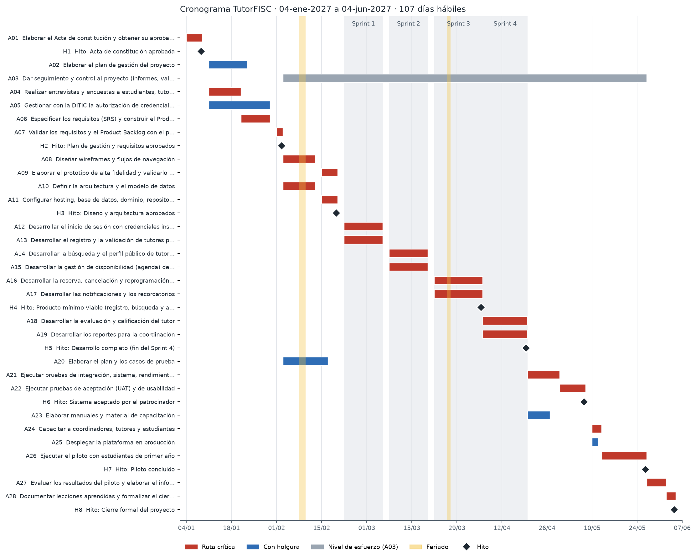

# 5. Cronograma y diagrama de Gantt

*Plataforma de tutorías entre estudiantes (TutorFISC) · Gerencia de Proyectos Informáticos (8469) · 1LS241*

El cronograma se calculó con el método de la ruta crítica (CPM) a partir del lunes 4 de enero de 2027. La duración total es de **107 días hábiles** y el proyecto finaliza el **viernes 4 de junio de 2027**, dentro de los 5 meses acordados. Feriados descontados: 08-feb-2027 (Lunes de Carnaval); 09-feb-2027 (Martes de Carnaval); 26-mar-2027 (Viernes Santo).

*Figura 2. Diagrama de Gantt (en rojo, la ruta crítica; rombos, los hitos).*

## Tabla del cronograma

| ID | EDT | Actividad | Dur. | Inicio | Fin | Holgura | ¿Crítica? |
|---|---|---|---|---|---|---|---|
| A01 | 1.1.1 | Elaborar el Acta de constitución y obtener su aprobación | 5 | 04-ene-2027 | 08-ene-2027 | 0 | Sí |
| H1 | 1.1.1 | Hito: Acta de constitución aprobada | 0 | 08-ene-2027 | 08-ene-2027 | 102 | No |
| A02 | 1.1.2 | Elaborar el plan de gestión del proyecto | 10 | 11-ene-2027 | 22-ene-2027 | 14 | No |
| A03 | 1.1.3 | Dar seguimiento y control al proyecto (informes, valor ganado, control de cambios) | 78 | 03-feb-2027 | 26-may-2027 | 7 | No |
| A04 | 1.2.1 | Realizar entrevistas y encuestas a estudiantes, tutores y coordinación | 8 | 11-ene-2027 | 20-ene-2027 | 0 | Sí |
| A05 | 1.2.1 | Gestionar con la DITIC la autorización de credenciales institucionales | 15 | 11-ene-2027 | 29-ene-2027 | 13 | No |
| A06 | 1.2.2 | Especificar los requisitos (SRS) y construir el Product Backlog | 7 | 21-ene-2027 | 29-ene-2027 | 0 | Sí |
| A07 | 1.2.2 | Validar los requisitos y el Product Backlog con el patrocinador | 2 | 01-feb-2027 | 02-feb-2027 | 0 | Sí |
| H2 | 1.2.2 | Hito: Plan de gestión y requisitos aprobados | 0 | 02-feb-2027 | 02-feb-2027 | 7 | No |
| A08 | 1.3.1 | Diseñar wireframes y flujos de navegación | 6 | 03-feb-2027 | 12-feb-2027 | 0 | Sí |
| A09 | 1.3.1 | Elaborar el prototipo de alta fidelidad y validarlo con usuarios | 5 | 15-feb-2027 | 19-feb-2027 | 0 | Sí |
| A10 | 1.3.2 | Definir la arquitectura y el modelo de datos | 6 | 03-feb-2027 | 12-feb-2027 | 0 | Sí |
| A11 | 1.3.3 | Configurar hosting, base de datos, dominio, repositorio y CI/CD | 5 | 15-feb-2027 | 19-feb-2027 | 0 | Sí |
| H3 | 1.3.3 | Hito: Diseño y arquitectura aprobados | 0 | 19-feb-2027 | 19-feb-2027 | 0 | Sí |
| A12 | 1.4.1 | Desarrollar el inicio de sesión con credenciales institucionales y el perfil del estudiante | 10 | 22-feb-2027 | 05-mar-2027 | 0 | Sí |
| A13 | 1.4.2 | Desarrollar el registro y la validación de tutores por materia | 10 | 22-feb-2027 | 05-mar-2027 | 0 | Sí |
| A14 | 1.5.1 | Desarrollar la búsqueda y el perfil público de tutores | 10 | 08-mar-2027 | 19-mar-2027 | 0 | Sí |
| A15 | 1.5.2 | Desarrollar la gestión de disponibilidad (agenda) del tutor | 10 | 08-mar-2027 | 19-mar-2027 | 0 | Sí |
| A16 | 1.5.2 | Desarrollar la reserva, cancelación y reprogramación de sesiones | 10 | 22-mar-2027 | 05-abr-2027 | 0 | Sí |
| A17 | 1.5.3 | Desarrollar las notificaciones y los recordatorios | 10 | 22-mar-2027 | 05-abr-2027 | 0 | Sí |
| H4 | 1.5.3 | Hito: Producto mínimo viable (registro, búsqueda y agenda) | 0 | 05-abr-2027 | 05-abr-2027 | 44 | No |
| A18 | 1.6.1 | Desarrollar la evaluación y calificación del tutor | 10 | 06-abr-2027 | 19-abr-2027 | 0 | Sí |
| A19 | 1.6.2 | Desarrollar los reportes para la coordinación | 10 | 06-abr-2027 | 19-abr-2027 | 0 | Sí |
| H5 | 1.6.2 | Hito: Desarrollo completo (fin del Sprint 4) | 0 | 19-abr-2027 | 19-abr-2027 | 0 | Sí |
| A20 | 1.7.1 | Elaborar el plan y los casos de prueba | 8 | 03-feb-2027 | 16-feb-2027 | 43 | No |
| A21 | 1.7.1 | Ejecutar pruebas de integración, sistema, rendimiento y seguridad | 8 | 20-abr-2027 | 29-abr-2027 | 0 | Sí |
| A22 | 1.7.2 | Ejecutar pruebas de aceptación (UAT) y de usabilidad | 6 | 30-abr-2027 | 07-may-2027 | 0 | Sí |
| H6 | 1.7.2 | Hito: Sistema aceptado por el patrocinador | 0 | 07-may-2027 | 07-may-2027 | 0 | Sí |
| A23 | 1.8.1 | Elaborar manuales y material de capacitación | 5 | 20-abr-2027 | 26-abr-2027 | 9 | No |
| A24 | 1.8.1 | Capacitar a coordinadores, tutores y estudiantes | 3 | 10-may-2027 | 12-may-2027 | 0 | Sí |
| A25 | 1.8.2 | Desplegar la plataforma en producción | 2 | 10-may-2027 | 11-may-2027 | 1 | No |
| A26 | 1.8.2 | Ejecutar el piloto con estudiantes de primer año | 10 | 13-may-2027 | 26-may-2027 | 0 | Sí |
| H7 | 1.8.2 | Hito: Piloto concluido | 0 | 26-may-2027 | 26-may-2027 | 0 | Sí |
| A27 | 1.9.1 | Evaluar los resultados del piloto y elaborar el informe final | 4 | 27-may-2027 | 01-jun-2027 | 0 | Sí |
| A28 | 1.9.2 | Documentar lecciones aprendidas y formalizar el cierre | 3 | 02-jun-2027 | 04-jun-2027 | 0 | Sí |
| H8 | 1.9.2 | Hito: Cierre formal del proyecto | 0 | 04-jun-2027 | 04-jun-2027 | 0 | Sí |

## Ruta crítica

La ruta crítica es: **A01 → A04 → A06 → A07 → (A08 ∥ A10) → (A09 ∥ A11) → H3 → (A12 ∥ A13) → (A14 ∥ A15) → (A16 ∥ A17) → (A18 ∥ A19) → H5 → A21 → A22 → H6 → A24 → A26 → H7 → A27 → A28 → H8**. Sus actividades tienen holgura cero; cualquier retraso en ellas retrasa la fecha de cierre. El símbolo ∥ indica actividades paralelas igualmente críticas: en cada sprint ambos desarrolladores están en la ruta crítica.

| Concepto | Resultado |
|---|---|
| Duración total del proyecto | 107 días hábiles (04-ene-2027 – 04-jun-2027) |
| Actividades de la ruta crítica | A01, A04, A06, A07, A08, A09, A10, A11, A12, A13, A14, A15, A16, A17, A18, A19, A21, A22, A24, A26, A27, A28 |
| Actividad con mayor holgura | A20 – Elaborar el plan y los casos de prueba (43 días) |
| Fecha estimada de finalización | viernes 4 de junio de 2027 |

La holgura de 13 días de A05 (autorización de la DITIC) funciona como amortiguador del riesgo R03: si la autorización se retrasa hasta 13 días, el Sprint 1 no se afecta. Para acortar el proyecto se actuaría solo sobre la ruta crítica: ejecución rápida (fast tracking) solapando A22 (UAT) con A23–A24 o intensificación (crashing) agregando un desarrollador temporal en los sprints, con costo adicional.

## Hitos

| Hito | Descripción | Fecha | Predecesoras |
|---|---|---|---|
| H1 | Acta de constitución aprobada | 08-ene-2027 | A01 |
| H2 | Plan de gestión y requisitos aprobados | 02-feb-2027 | A02, A07 |
| H3 | Diseño y arquitectura aprobados | 19-feb-2027 | A09, A11 |
| H4 | Producto mínimo viable (registro, búsqueda y agenda) | 05-abr-2027 | A16, A17 |
| H5 | Desarrollo completo (fin del Sprint 4) | 19-abr-2027 | A18, A19 |
| H6 | Sistema aceptado por el patrocinador | 07-may-2027 | A22 |
| H7 | Piloto concluido | 26-may-2027 | A26 |
| H8 | Cierre formal del proyecto | 04-jun-2027 | A28 |

## Sprints de construcción

| Sprint | Inicio | Fin | Actividades | Paquetes EDT | Story points |
|---|---|---|---|---|---|
| Sprint 1 | 22-feb-2027 | 05-mar-2027 | A12, A13 | 1.4.1, 1.4.2 | 24 |
| Sprint 2 | 08-mar-2027 | 19-mar-2027 | A14, A15 | 1.5.1, 1.5.2 | 21 |
| Sprint 3 | 22-mar-2027 | 05-abr-2027 | A16, A17 | 1.5.2, 1.5.3 | 24 |
| Sprint 4 | 06-abr-2027 | 19-abr-2027 | A18, A19 | 1.6.1, 1.6.2 | 24 |

## Archivos importables

- **cronograma/Cronograma_MSProject.xml** – formato MS Project XML; se abre en ProjectLibre (Archivo → Abrir) y en GanttProject (Proyecto → Importar). Incluye EDT, dependencias, hitos, calendario con feriados, recursos y asignaciones. Es la opción recomendada.
- **cronograma/Cronograma_GanttProject.csv** – CSV con las columnas de GanttProject (ID, Name, Begin date, End date, Duration, Predecessors, Outline number, Resources).
- **cronograma/Cronograma_PlanificadorGantt.csv** – CSV para el Planificador Gantt del curso (Importar / exportar).
- **cronograma/Actividades.csv** – tabla completa del cronograma para Excel.
