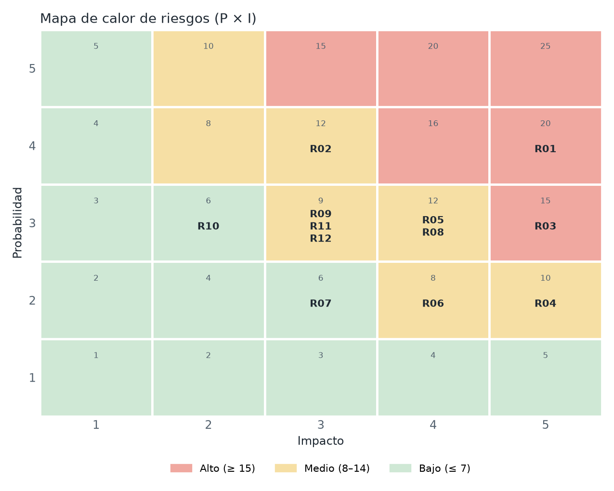

# 8. Matriz de riesgos

*Plataforma de tutorías entre estudiantes (TutorFISC) · Gerencia de Proyectos Informáticos (8469) · 1LS241*

Escalas: probabilidad e impacto de 1 (muy bajo) a 5 (muy alto). Nivel = P × I. Zonas: Alto ≥ 15, Medio 8–14, Bajo ≤ 7. Los riesgos R01, R03, R04, R05 y R06 son los riesgos de alto nivel declarados en el Acta.

## Identificación y análisis

| ID | Descripción | Causa | Categoría | P | I | Nivel |
|---|---|---|---|---|---|---|
| R01 | Pocos estudiantes avanzados se registran como tutores voluntarios. | Falta de incentivos y carga académica de los estudiantes avanzados. | Organizacional | 4 | 5 | 20 Alto |
| R02 | Ausentismo de estudiantes a las sesiones reservadas. | Olvido, choques de horario o reservas sin compromiso. | Operativo | 4 | 3 | 12 Medio |
| R03 | Demora de la UTP (DITIC) en autorizar la integración con credenciales institucionales. | Trámites internos de seguridad y aprobación de aplicaciones en el directorio institucional. | Externo | 3 | 5 | 15 Alto |
| R04 | Incumplimiento de la protección de datos personales (Ley 81 de 2019 de Panamá) o filtración de datos académicos. | Manejo de índices, notas y datos de contacto de estudiantes. | Legal / Seguridad | 2 | 5 | 10 Medio |
| R05 | Crecimiento no controlado del alcance (por ejemplo, pedir pagos o videollamadas). | Expectativas de interesados no alineadas con el Acta. | Gestión | 3 | 4 | 12 Medio |
| R06 | Rotación o ausencia prolongada de un integrante del equipo. | Enfermedad, renuncia u ofertas laborales externas. | Recursos | 2 | 4 | 8 Medio |
| R07 | Retraso en el aprovisionamiento de la infraestructura (hosting, base de datos o dominio). | Trámites de compra o restricciones de la red institucional. | Técnico | 2 | 3 | 6 Bajo |
| R08 | Baja adopción de la plataforma por parte de estudiantes de primer año. | Desconocimiento de la plataforma o preferencia por grupos de mensajería informales. | Organizacional | 3 | 4 | 12 Medio |
| R09 | Estimaciones de esfuerzo optimistas en los sprints de desarrollo. | Poca experiencia previa del equipo con integraciones institucionales. | Gestión | 3 | 3 | 9 Medio |
| R10 | Los correos de notificación llegan a la carpeta de spam o son bloqueados. | Filtros del correo institucional y reputación del dominio emisor. | Técnico | 3 | 2 | 6 Bajo |
| R11 | Baja disponibilidad de usuarios para entrevistas, UAT y piloto por el calendario académico. | Receso de verano, Carnaval, Semana Santa y período de exámenes. | Externo | 3 | 3 | 9 Medio |
| R12 | Los datos académicos (índice y notas) no están disponibles para validar a los tutores. | La Secretaría General no expone un servicio de consulta de calificaciones. | Externo | 3 | 3 | 9 Medio |

## Plan de respuesta

| ID | Estrategia | Acción de respuesta | Responsable | EDT |
|---|---|---|---|---|
| R01 | Mitigar | Campaña de difusión con la FISC, certificados de reconocimiento y gestión ante la facultad de horas de servicio social [SUPUESTO]; meta intermedia de 25 tutores al inicio del piloto. | Gerente de Proyecto | 1.8.2 |
| R02 | Mitigar | Recordatorios 24 h y 1 h antes (HU15), cancelación con 12 h de anticipación (HU13) y registro de asistencia (HU18). | Analista de Sistemas | 1.5.3 |
| R03 | Mitigar | Solicitud desde la semana 2 (A05) con holgura antes del Sprint 1; plan alterno: registro con verificación por correo @utp.ac.pa mediante código de un solo uso. | Gerente de Proyecto | 1.4.1 |
| R04 | Transferir | Auditoría de seguridad externa contratada (1.7.1), consentimiento informado, cifrado en tránsito y en reposo, mínimo privilegio y aviso de privacidad aprobado por Asesoría Legal. | QA / Tester | 1.7.1 |
| R05 | Evitar | Alcance excluido explícito en el Acta; toda solicitud pasa por el control integrado de cambios y el Product Owner prioriza el backlog. | Gerente de Proyecto | 1.1.3 |
| R06 | Mitigar | Programación en pares, revisión de código cruzada, documentación en el repositorio y matriz de respaldo entre roles. | Gerente de Proyecto | 1.1.3 |
| R07 | Mitigar | Infraestructura como código y proveedor alterno precalificado; inicio de 1.3.3 con holgura respecto al Sprint 1. | Desarrollador 2 | 1.3.3 |
| R08 | Mitigar | Presentación en inducción de primer año, docentes como promotores y diseño validado con usuarios (1.3.1). | Analista de Sistemas | 1.8.2 |
| R09 | Mitigar | Estimación con Planning Poker, velocidad medida desde el Sprint 1 y reserva de capacidad del 15 % por sprint. | Desarrollador 1 | 1.5.2 |
| R10 | Mitigar | Configurar SPF, DKIM y DMARC; coordinar con la DITIC una lista blanca y ofrecer notificaciones dentro de la plataforma (HU16). | Desarrollador 2 | 1.5.3 |
| R11 | Aceptar | Aceptación activa: el cronograma ya descuenta los feriados; se agenda el UAT y el piloto en semanas de clase y se usa encuesta en línea. | Analista de Sistemas | 1.7.2 |
| R12 | Mitigar | Validación con archivo de calificaciones autorizado (CSV) o constancia de créditos subida por el postulante y verificada por la coordinación. | Analista de Sistemas | 1.4.2 |

## Mapa de calor

*Figura 3. Mapa de calor probabilidad × impacto.*

| Probabilidad \ Impacto | I = 1 | I = 2 | I = 3 | I = 4 | I = 5 |
|---|---|---|---|---|---|
| P = 5 | · | · | · | · | · |
| P = 4 | · | · | R02 | · | R01 |
| P = 3 | · | R10 | R09 R11 R12 | R05 R08 | R03 |
| P = 2 | · | · | R07 | R06 | R04 |
| P = 1 | · | · | · | · | · |

## Cálculo de la reserva de contingencia (EMV)

| ID | Probabilidad | Impacto en costo | EMV |
|---|---|---|---|
| R01 | 70% | B/. 1,000.00 | B/. 700.00 |
| R02 | 70% | B/. 400.00 | B/. 280.00 |
| R03 | 50% | B/. 1,800.00 | B/. 900.00 |
| R04 | 30% | B/. 1,500.00 | B/. 450.00 |
| R05 | 50% | B/. 1,200.00 | B/. 600.00 |
| R06 | 30% | B/. 1,500.00 | B/. 450.00 |
| R07 | 30% | B/. 400.00 | B/. 120.00 |
| R08 | 50% | B/. 600.00 | B/. 300.00 |
| R09 | 50% | B/. 900.00 | B/. 450.00 |
| R10 | 50% | B/. 300.00 | B/. 150.00 |
| R11 | 50% | B/. 300.00 | B/. 150.00 |
| R12 | 50% | B/. 400.00 | B/. 200.00 |
| **Total** |  |  | **B/. 4,750.00** |

Conversión de la escala de probabilidad: 1 = 10 %, 2 = 30 %, 3 = 50 %, 4 = 70 %, 5 = 90 % [SUPUESTO]. El total redondeado (B/. 4,750.00) es la reserva de contingencia del presupuesto.
