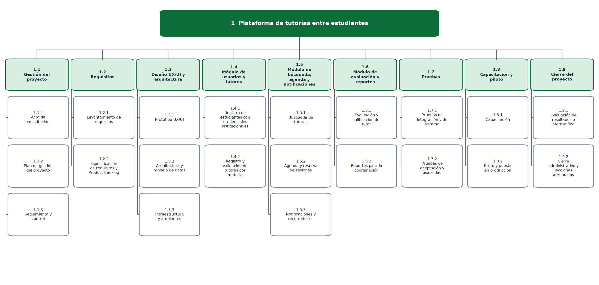
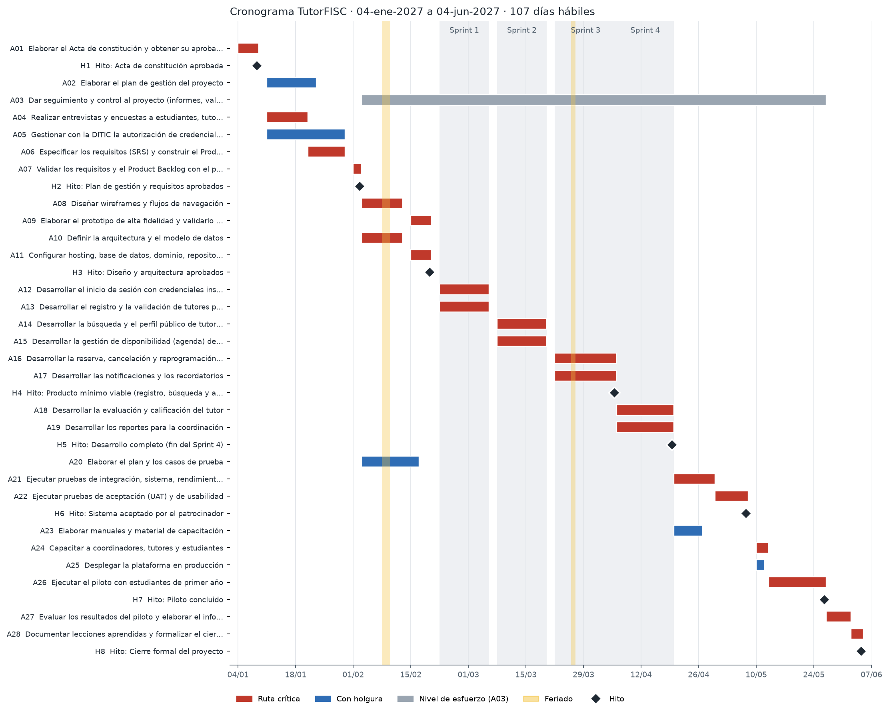
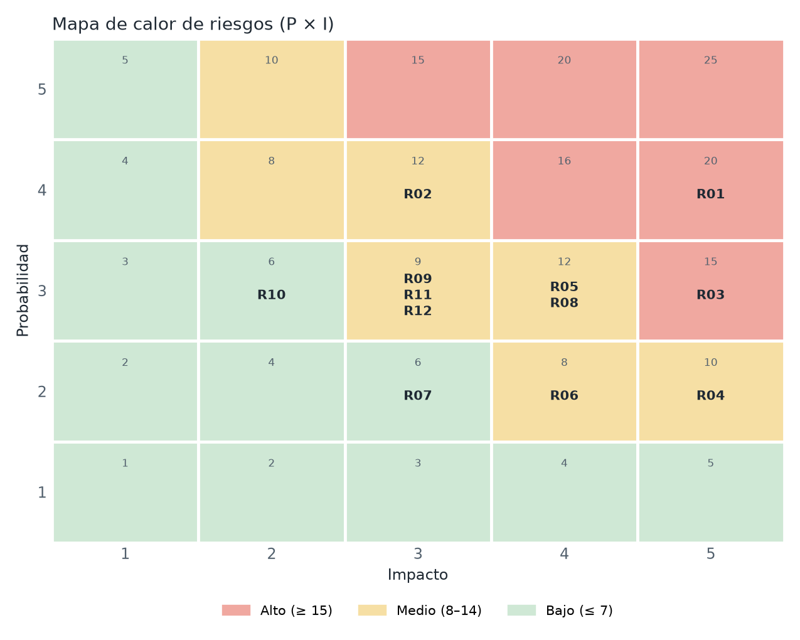

# Plan de Gestión del Proyecto – Plataforma de tutorías entre estudiantes (TutorFISC)

**Universidad Tecnológica de Panamá** · Facultad de Ingeniería de Sistemas Computacionales  
Gerencia de Proyectos Informáticos (8469) · Grupo 1LS241 · II Semestre 2026  
Equipo N.º ____ · Integrantes: ________ · Docente: ________ · Fecha: ________

## Índice

1. Ficha de la idea
2. Acta de constitución del proyecto (Project Charter)
3. Estructura de desglose del trabajo (EDT / WBS)
4. Lista de actividades
5. Cronograma y diagrama de Gantt
6. Matriz RACI
7. Presupuesto
8. Matriz de riesgos
9. Plan de gestión de la calidad
10. Product Backlog
11. Plan del Sprint 1
12. Guion de exposición
13. Lista de verificación de coherencia

## Introducción

El presente documento constituye el plan de gestión del proyecto «Plataforma de tutorías entre estudiantes (TutorFISC)», elaborado para el curso Gerencia de Proyectos Informáticos. El proyecto responde a una necesidad concreta de la Facultad de Ingeniería de Sistemas Computacionales: los estudiantes de primer año no encuentran apoyo académico oportuno, mientras que existen estudiantes avanzados dispuestos a ofrecerlo sin un canal organizado.

El plan adopta un enfoque híbrido. La iniciación y la planificación siguen el enfoque predictivo de la Guía del PMBOK® —acta de constitución, EDT, cronograma con ruta crítica, matriz RACI, presupuesto, riesgos y calidad—, mientras que la construcción del producto se organiza en cuatro sprints de Scrum, guiados por un Product Backlog vinculado a la EDT.

Todos los entregables se generaron a partir de una única fuente de datos, de modo que los códigos de la EDT, las fechas, las asignaciones y los montos son idénticos en cada sección. El proyecto simulado inicia el lunes 4 de enero de 2027 y finaliza el viernes 4 de junio de 2027, con un presupuesto total de B/. 65,111.76.

## 1. Ficha de la idea

| Campo | Contenido |
|---|---|
| N.º de equipo | ______ |
| Integrantes | 1. ______________________<br>2. ______________________<br>3. ______________________<br>4. ______________________<br>5. ______________________ |
| Curso / Grupo | Gerencia de Proyectos Informáticos (8469) · Grupo 1LS241 · II Semestre 2026 |
| Idea elegida | Plataforma de tutorías entre estudiantes (TutorFISC): aplicación web responsive en la que estudiantes avanzados de la FISC, validados por materia, ofrecen tutorías a estudiantes de primer año, quienes los buscan, reservan sesiones y los evalúan. |
| Cliente / patrocinador | Facultad de Ingeniería de Sistemas Computacionales (FISC) de la UTP. |

### Problema

Los estudiantes de primer año de la FISC no encuentran apoyo académico oportuno. Hoy la ayuda entre pares depende de contactos personales y de grupos informales de mensajería: no existe un registro de quiénes pueden dar tutoría en cada materia, ni una forma de verificar que dominan la materia, ni de agendar, recordar o evaluar las sesiones. Como consecuencia, el estudiante busca ayuda tarde —usualmente cerca de los parciales— y la coordinación no dispone de datos para identificar las materias con mayor necesidad de apoyo.

### Usuarios e interesados principales

| Interesado | Rol en el proyecto | Interés principal |
|---|---|---|
| Estudiantes de primer año | Usuarios finales (reciben tutoría) | Conseguir apoyo rápido y confiable. |
| Estudiantes avanzados (tutores) | Usuarios finales (ofrecen tutoría) | Organizar su tiempo y obtener reconocimiento. |
| Coordinación académica de la FISC | Usuario administrador | Controlar la calidad y obtener indicadores. |
| Decanato de la FISC | Patrocinador | Mejorar el rendimiento y la retención de primer año. |
| DITIC de la UTP [SUPUESTO: unidad de TI institucional] | Proveedor de credenciales e infraestructura | Seguridad e integración con los servicios institucionales. |
| Docentes de materias de primer año | Promotores | Que sus estudiantes refuercen contenidos. |

### ¿Por qué se eligió?

- **Problema real y cercano:** el equipo lo vivió en su primer año, lo que facilita el levantamiento de requisitos.
- **Alcance acotado y medible:** cuatro capacidades centrales (registro y validación de tutores, búsqueda, agenda y evaluación) caben en 5 meses con un equipo de 6 roles.
- **Patrocinador accesible:** la FISC es a la vez cliente y usuario, lo que permite validar entregables con rapidez.
- **Permite aplicar todo el curso:** combina un ciclo predictivo (Acta, EDT, Gantt, presupuesto) con desarrollo ágil por sprints (backlog, Scrum).
- **Impacto social:** apoyo entre pares de bajo costo, sin pagos, que puede extenderse a otras facultades.

## 2. Acta de constitución del proyecto (Project Charter)

| Campo | Contenido |
|---|---|
| Título del proyecto | Plataforma de tutorías entre estudiantes (TutorFISC) |
| Patrocinador | Decanato de la Facultad de Ingeniería de Sistemas Computacionales (FISC), Universidad Tecnológica de Panamá. |
| Gerente de Proyecto | Gerente de Proyecto del equipo simulado (con autoridad para asignar los recursos aprobados en esta Acta). |
| Fecha de inicio / fin | lunes 4 de enero de 2027 / viernes 4 de junio de 2027 (107 días hábiles, 5 meses) |
| Presupuesto total autorizado | B/. 65,111.76 |
| Enfoque | Híbrido: planificación predictiva (EDT, cronograma, costos) y construcción ágil con Scrum en 4 sprints de 2 semanas. |

### Justificación

La FISC necesita aumentar el apoyo académico a los estudiantes de primer año, etapa en la que se concentran la reprobación y la deserción. Existe una oferta potencial de estudiantes avanzados dispuestos a apoyar, pero no hay un mecanismo que conecte la oferta con la demanda, garantice la idoneidad del tutor y genere datos para la gestión. Una plataforma web de bajo costo, integrada con las credenciales institucionales, resuelve ese vacío sin requerir contratación de personal docente adicional.

### Objetivo general

Implementar, en un plazo de 5 meses y con un presupuesto de B/. 65,111.76, una plataforma web responsive que permita a los estudiantes de primer año de la FISC encontrar, reservar y evaluar tutorías impartidas por estudiantes avanzados validados por materia, y que proporcione a la coordinación indicadores para gestionar el programa.

### Objetivos específicos (SMART)

| ID | Objetivo | Indicador de medición |
|---|---|---|
| OE1 | Registrar y validar al menos 40 tutores que cubran como mínimo 12 materias de primer año de la FISC al finalizar el piloto (26-may-2027). | N.º de tutores aprobados y materias cubiertas (reporte HU20). |
| OE2 | Lograr que al menos 100 estudiantes de primer año se registren y que se realicen al menos 120 sesiones de tutoría durante las dos semanas del piloto. | Estudiantes registrados y sesiones con asistencia marcada. |
| OE3 | Reducir el tiempo para conseguir una tutoría de 7 días [SUPUESTO: línea base de la encuesta de 1.2.1] a menos de 48 horas entre la búsqueda y la sesión, medido durante el piloto. | Promedio de horas entre la reserva y la sesión. |
| OE4 | Alcanzar una satisfacción de los estudiantes mayor al 80 % y un puntaje SUS ≥ 70 en la encuesta aplicada al cierre del piloto. | Encuesta posterior a la sesión y cuestionario SUS. |
| OE5 | Entregar la plataforma en producción y cerrar el proyecto a más tardar el 04-jun-2027 con un desempeño de costo y tiempo CPI ≥ 0.95 y SPI ≥ 0.95. | Acta de cierre e informe de valor ganado. |

### Alcance de alto nivel

| Incluye | Excluye |
|---|---|
| • Registro y validación de tutores por materia (nota aprobada e índice mínimo).<br>• Registro de estudiantes con credenciales institucionales.<br>• Búsqueda de tutores.<br>• Agenda y reserva de sesiones.<br>• Notificaciones y recordatorios.<br>• Evaluación y calificación del tutor.<br>• Reportes para la coordinación.<br>• Pruebas, capacitación y piloto. | • Pagos a tutores o cobros a estudiantes.<br>• Videollamada integrada (se registra un enlace externo).<br>• Aplicación móvil nativa (la solución es web responsive).<br>• Integración en línea con el sistema de matrícula.<br>• Soporte y mantenimiento posteriores al cierre (se transfieren a la DITIC). |

### Entregables principales

- 1.1 Gestión del proyecto — Acta de constitución firmada; Plan de gestión aprobado (línea base de alcance, tiempo y costo); Informes de avance quincenales y registro de cambios actualizado.
- 1.2 Requisitos — Informe de levantamiento y autorización de integración con credenciales institucionales; SRS y Product Backlog priorizado y estimado.
- 1.3 Diseño UX/UI y arquitectura — Prototipo navegable en Figma y guía de estilo; Documento de arquitectura y modelo de datos; Ambientes de desarrollo, pruebas (staging) y producción operativos.
- 1.4 Módulo de usuarios y tutores — Incremento funcional de autenticación y perfiles; Incremento funcional de registro y validación de tutores.
- 1.5 Módulo de búsqueda, agenda y notificaciones — Incremento funcional de búsqueda; Incremento funcional de agenda y reservas; Incremento funcional de notificaciones.
- 1.6 Módulo de evaluación y reportes — Incremento funcional de evaluación; Incremento funcional de reportes.
- 1.7 Pruebas — Plan de pruebas, casos de prueba e informe de pruebas de sistema; Informe de UAT y acta de aceptación del sistema.
- 1.8 Capacitación y piloto — Manuales, videotutoriales y registro de asistencia a capacitaciones; Plataforma en producción e informe de operación del piloto.
- 1.9 Cierre del proyecto — Informe final del proyecto; Acta de cierre y registro de lecciones aprendidas.

### Interesados (matriz poder / interés)

| Interesado | Poder | Interés | Cuadrante | Estrategia |
|---|---|---|---|---|
| Decanato de la FISC (patrocinador) | Alto | Alto | Gestionar de cerca | Aprobaciones en hitos, informe quincenal. |
| Coordinación académica de la FISC | Alto | Alto | Gestionar de cerca | Product Owner delegado: asiste a cada Sprint Review. |
| DITIC de la UTP | Alto | Bajo | Mantener satisfecho | Consultar en decisiones de seguridad e integración. |
| Secretaría General (calificaciones) | Alto | Bajo | Mantener satisfecho | Solicitud formal de datos académicos. |
| Estudiantes de primer año | Bajo | Alto | Mantener informado | Encuestas, pruebas de usabilidad y difusión. |
| Estudiantes tutores | Bajo | Alto | Mantener informado | Grupo focal, capacitación y reconocimiento. |
| Docentes de primer año | Bajo | Bajo | Monitorear | Comunicados en momentos clave. |

### Equipo del proyecto

| Rol | Responsabilidades principales |
|---|---|
| Gerente de Proyecto | Planificar, dirigir y controlar el proyecto; Scrum Master; enlace con el patrocinador. |
| Analista de Sistemas | Levantar y especificar requisitos; Product Owner delegado por la coordinación; capacitación. |
| Diseñador UX/UI | Investigación de usuarios, prototipos, guía de estilo y pruebas de usabilidad. |
| Desarrollador 1 | Líder técnico: arquitectura, autenticación institucional, agenda/reservas y reportes. |
| Desarrollador 2 | Infraestructura y CI/CD, tutores, búsqueda, notificaciones y evaluación. |
| QA / Tester | Plan de pruebas, pruebas funcionales, de integración, rendimiento, seguridad y UAT. |

### Supuestos

- La FISC designa a un coordinador con disponibilidad de 4 h semanales para validar entregables.
- La DITIC autoriza la autenticación con las cuentas institucionales antes del Sprint 1 (22-feb-2027).
- Existen al menos 40 estudiantes avanzados interesados en ser tutores [SUPUESTO].
- La Secretaría General entrega un archivo autorizado de calificaciones para validar a los tutores.
- El primer semestre académico de 2027 está en curso durante el piloto (mayo de 2027).

### Restricciones

- Tiempo: 5 meses, del 04-ene-2027 al 04-jun-2027.
- Costo: presupuesto máximo de B/. 65,111.76 (incluye reservas).
- Alcance: sin pagos, sin videollamada integrada, sin aplicación nativa.
- Normativa: Ley 81 de 2019 de protección de datos personales y políticas de seguridad de la UTP.
- Tecnología: web responsive compatible con los navegadores actuales y con el correo institucional.

### Riesgos de alto nivel

| ID | Riesgo | Nivel (P×I) |
|---|---|---|
| R01 | Pocos estudiantes avanzados se registran como tutores voluntarios. | 20 (Alto) |
| R03 | Demora de la UTP (DITIC) en autorizar la integración con credenciales institucionales. | 15 (Alto) |
| R04 | Incumplimiento de la protección de datos personales (Ley 81 de 2019 de Panamá) o filtración de datos académicos. | 10 (Medio) |
| R05 | Crecimiento no controlado del alcance (por ejemplo, pedir pagos o videollamadas). | 12 (Medio) |
| R06 | Rotación o ausencia prolongada de un integrante del equipo. | 8 (Medio) |

### Hitos principales

| Hito | Descripción | Fecha |
|---|---|---|
| H1 | Acta de constitución aprobada | 08-ene-2027 |
| H2 | Plan de gestión y requisitos aprobados | 02-feb-2027 |
| H3 | Diseño y arquitectura aprobados | 19-feb-2027 |
| H4 | Producto mínimo viable (registro, búsqueda y agenda) | 05-abr-2027 |
| H5 | Desarrollo completo (fin del Sprint 4) | 19-abr-2027 |
| H6 | Sistema aceptado por el patrocinador | 07-may-2027 |
| H7 | Piloto concluido | 26-may-2027 |
| H8 | Cierre formal del proyecto | 04-jun-2027 |

### Presupuesto resumido

| Concepto | Monto |
|---|---|
| Personal (horas del cronograma × tarifa) | B/. 51,810.76 |
| Costos directos (infraestructura, licencias, equipos, capacitación y otros) | B/. 5,450.00 |
| Reserva de contingencia (8.3%) | B/. 4,750.00 |
| **Línea base de costos** | **B/. 62,010.76** |
| Reserva de gestión (5%) | B/. 3,101.00 |
| **Presupuesto total del proyecto** | **B/. 65,111.76** |

### Criterios de éxito

- Cumplimiento de los objetivos OE1 a OE5 medidos en el informe final.
- Plataforma en producción con 0 defectos críticos abiertos.
- Cierre a más tardar el 04-jun-2027 con una variación de costo no mayor al 5 % de la línea base.
- Acta de aceptación y acta de cierre firmadas por el patrocinador.

### Firmas de aprobación

| Rol | Nombre | Firma | Fecha |
|---|---|---|---|
| Patrocinador – Decanato de la FISC |  |  |  |
| Coordinación académica de la FISC |  |  |  |
| Gerente de Proyecto |  |  |  |

## 3. Estructura de desglose del trabajo (EDT / WBS)

La EDT se organiza por entregables en tres niveles: el proyecto (nivel 1), 9 entregables (nivel 2) y 21 paquetes de trabajo (nivel 3). Cumple la regla del 100 %: cada elemento del alcance incluido en el Acta está representado en al menos un paquete y no existe trabajo fuera del alcance.

### EDT codificada

| Código | Nivel | Nombre del elemento | Tipo |
|---|---|---|---|
| 1 | 1 | Plataforma de tutorías entre estudiantes | Proyecto |
| 1.1 | 2 | Gestión del proyecto | Entregable |
| 1.1.1 | 3 | Acta de constitución | Paquete de trabajo |
| 1.1.2 | 3 | Plan de gestión del proyecto | Paquete de trabajo |
| 1.1.3 | 3 | Seguimiento y control | Paquete de trabajo |
| 1.2 | 2 | Requisitos | Entregable |
| 1.2.1 | 3 | Levantamiento de requisitos | Paquete de trabajo |
| 1.2.2 | 3 | Especificación de requisitos y Product Backlog | Paquete de trabajo |
| 1.3 | 2 | Diseño UX/UI y arquitectura | Entregable |
| 1.3.1 | 3 | Prototipo UX/UI | Paquete de trabajo |
| 1.3.2 | 3 | Arquitectura y modelo de datos | Paquete de trabajo |
| 1.3.3 | 3 | Infraestructura y ambientes | Paquete de trabajo |
| 1.4 | 2 | Módulo de usuarios y tutores | Entregable |
| 1.4.1 | 3 | Registro de estudiantes con credenciales institucionales | Paquete de trabajo |
| 1.4.2 | 3 | Registro y validación de tutores por materia | Paquete de trabajo |
| 1.5 | 2 | Módulo de búsqueda, agenda y notificaciones | Entregable |
| 1.5.1 | 3 | Búsqueda de tutores | Paquete de trabajo |
| 1.5.2 | 3 | Agenda y reserva de sesiones | Paquete de trabajo |
| 1.5.3 | 3 | Notificaciones y recordatorios | Paquete de trabajo |
| 1.6 | 2 | Módulo de evaluación y reportes | Entregable |
| 1.6.1 | 3 | Evaluación y calificación del tutor | Paquete de trabajo |
| 1.6.2 | 3 | Reportes para la coordinación | Paquete de trabajo |
| 1.7 | 2 | Pruebas | Entregable |
| 1.7.1 | 3 | Pruebas de integración y de sistema | Paquete de trabajo |
| 1.7.2 | 3 | Pruebas de aceptación y usabilidad | Paquete de trabajo |
| 1.8 | 2 | Capacitación y piloto | Entregable |
| 1.8.1 | 3 | Capacitación | Paquete de trabajo |
| 1.8.2 | 3 | Piloto y puesta en producción | Paquete de trabajo |
| 1.9 | 2 | Cierre del proyecto | Entregable |
| 1.9.1 | 3 | Evaluación de resultados e informe final | Paquete de trabajo |
| 1.9.2 | 3 | Cierre administrativo y lecciones aprendidas | Paquete de trabajo |

### EDT en forma de árbol



*Figura 1. EDT del proyecto en forma de árbol.*

```
1 Plataforma de tutorías entre estudiantes
├── 1.1 Gestión del proyecto
│   ├── 1.1.1 Acta de constitución
│   ├── 1.1.2 Plan de gestión del proyecto
│   └── 1.1.3 Seguimiento y control
├── 1.2 Requisitos
│   ├── 1.2.1 Levantamiento de requisitos
│   └── 1.2.2 Especificación de requisitos y Product Backlog
├── 1.3 Diseño UX/UI y arquitectura
│   ├── 1.3.1 Prototipo UX/UI
│   ├── 1.3.2 Arquitectura y modelo de datos
│   └── 1.3.3 Infraestructura y ambientes
├── 1.4 Módulo de usuarios y tutores
│   ├── 1.4.1 Registro de estudiantes con credenciales institucionales
│   └── 1.4.2 Registro y validación de tutores por materia
├── 1.5 Módulo de búsqueda, agenda y notificaciones
│   ├── 1.5.1 Búsqueda de tutores
│   ├── 1.5.2 Agenda y reserva de sesiones
│   └── 1.5.3 Notificaciones y recordatorios
├── 1.6 Módulo de evaluación y reportes
│   ├── 1.6.1 Evaluación y calificación del tutor
│   └── 1.6.2 Reportes para la coordinación
├── 1.7 Pruebas
│   ├── 1.7.1 Pruebas de integración y de sistema
│   └── 1.7.2 Pruebas de aceptación y usabilidad
├── 1.8 Capacitación y piloto
│   ├── 1.8.1 Capacitación
│   └── 1.8.2 Piloto y puesta en producción
└── 1.9 Cierre del proyecto
    ├── 1.9.1 Evaluación de resultados e informe final
    └── 1.9.2 Cierre administrativo y lecciones aprendidas
```

### Verificación de la regla del 100 %

| Elemento del alcance (Acta) | Paquete(s) de la EDT |
|---|---|
| Registro y validación de tutores por materia | 1.4.2 |
| Registro de estudiantes con credenciales institucionales | 1.4.1 (y 1.2.1 para la autorización de la DITIC) |
| Búsqueda de tutores | 1.5.1 |
| Agenda y reserva de sesiones | 1.5.2 |
| Notificaciones y recordatorios | 1.5.3 |
| Evaluación y calificación del tutor | 1.6.1 |
| Reportes para la coordinación | 1.6.2 |
| Pruebas | 1.7.1, 1.7.2 (las pruebas unitarias forman parte de cada módulo por la Definition of Done) |
| Capacitación y piloto | 1.8.1, 1.8.2 |
| Gestión del proyecto y cierre | 1.1.1–1.1.3, 1.9.1, 1.9.2 |

### Diccionario de la EDT

| Código | Paquete | Descripción | Entregable | Criterio de aceptación | Responsable (A) |
|---|---|---|---|---|---|
| 1.1.1 | Acta de constitución | Definición del propósito, objetivos SMART, alcance de alto nivel, interesados, hitos y presupuesto resumido; obtención de la autorización formal del patrocinador. | Acta de constitución firmada. | Firmada por el patrocinador (FISC) y el Gerente de Proyecto; contiene todas las secciones de la plantilla del curso. | Patrocinador |
| 1.1.2 | Plan de gestión del proyecto | Elaboración de los planes subsidiarios: alcance (EDT), cronograma, costos, calidad, riesgos, recursos (RACI) y comunicaciones. | Plan de gestión aprobado (línea base de alcance, tiempo y costo). | Revisado por el patrocinador; líneas base coherentes entre sí (lista de verificación de coherencia sin observaciones). | Gerente de Proyecto |
| 1.1.3 | Seguimiento y control | Reuniones de seguimiento, informes de avance quincenales, gestión del valor ganado (SPI/CPI), control integrado de cambios y actualización del registro de riesgos. | Informes de avance quincenales y registro de cambios actualizado. | Un informe por quincena entregado al patrocinador; 100 % de solicitudes de cambio registradas y resueltas en el comité. | Gerente de Proyecto |
| 1.2.1 | Levantamiento de requisitos | Entrevistas y encuestas a estudiantes de primer año, tutores potenciales y coordinación; gestión de la autorización de credenciales institucionales con la DITIC. | Informe de levantamiento y autorización de integración con credenciales institucionales. | Mínimo 60 encuestas y 8 entrevistas documentadas; autorización escrita de la DITIC o plan alterno aprobado. | Analista de Sistemas |
| 1.2.2 | Especificación de requisitos y Product Backlog | Redacción de la especificación de requisitos (SRS), historias de usuario con criterios de aceptación y priorización MoSCoW; validación con el patrocinador. | SRS y Product Backlog priorizado y estimado. | Backlog con 15–25 historias INVEST, cada una con criterios de aceptación y vinculada a la EDT; acta de validación firmada. | Gerente de Proyecto |
| 1.3.1 | Prototipo UX/UI | Wireframes, flujos de navegación, guía de estilo y prototipo navegable de alta fidelidad (web responsive), validado con usuarios. | Prototipo navegable en Figma y guía de estilo. | Prueba de usabilidad temprana con 5 usuarios; tasa de éxito de tareas ≥ 80 %; cumple contraste WCAG 2.1 AA. | Gerente de Proyecto |
| 1.3.2 | Arquitectura y modelo de datos | Definición de la arquitectura de la solución (web responsive, API REST, base de datos relacional), modelo entidad-relación y decisiones técnicas. | Documento de arquitectura y modelo de datos. | Revisado por el Gerente de Proyecto y el Analista; cubre el 100 % de las historias Must del backlog. | Desarrollador 1 |
| 1.3.3 | Infraestructura y ambientes | Configuración del hosting en la nube, base de datos gestionada, dominio, certificado TLS, repositorio, integración y despliegue continuos (CI/CD) y ambientes de desarrollo, pruebas y producción. | Ambientes de desarrollo, pruebas (staging) y producción operativos. | Despliegue automático a staging desde la rama principal; HTTPS activo; respaldo diario configurado. | Desarrollador 1 |
| 1.4.1 | Registro de estudiantes con credenciales institucionales | Inicio de sesión con la cuenta institucional @utp.ac.pa, perfil del estudiante y gestión de roles (Sprint 1). | Incremento funcional de autenticación y perfiles. | Historias HU01–HU03 aceptadas en la Sprint Review conforme a la Definition of Done. | Desarrollador 1 |
| 1.4.2 | Registro y validación de tutores por materia | Postulación de tutores, validación automática de requisitos académicos por materia y aprobación por la coordinación (Sprint 1). | Incremento funcional de registro y validación de tutores. | Historias HU04–HU06 aceptadas en la Sprint Review conforme a la Definition of Done. | Desarrollador 1 |
| 1.5.1 | Búsqueda de tutores | Búsqueda y filtrado de tutores por materia, horario y modalidad; perfil público del tutor (Sprint 2). | Incremento funcional de búsqueda. | Historias HU07–HU09 aceptadas; tiempo de respuesta de la búsqueda ≤ 2 s (p95). | Desarrollador 1 |
| 1.5.2 | Agenda y reserva de sesiones | Disponibilidad del tutor (Sprint 2) y reserva, cancelación y reprogramación de sesiones sin traslapes (Sprint 3). | Incremento funcional de agenda y reservas. | Historias HU10–HU13 aceptadas; cero reservas duplicadas en pruebas de concurrencia. | Desarrollador 1 |
| 1.5.3 | Notificaciones y recordatorios | Confirmaciones por correo, recordatorios automáticos 24 h y 1 h antes de la sesión y notificaciones dentro de la plataforma (Sprint 3). | Incremento funcional de notificaciones. | Historias HU14–HU16 aceptadas; ≥ 98 % de correos entregados en staging. | Desarrollador 1 |
| 1.6.1 | Evaluación y calificación del tutor | Calificación de 1 a 5 y comentario posterior a la sesión, registro de asistencia y moderación de comentarios (Sprint 4). | Incremento funcional de evaluación. | Historias HU17–HU19 aceptadas conforme a la Definition of Done. | Desarrollador 1 |
| 1.6.2 | Reportes para la coordinación | Tablero de indicadores para la coordinación y exportación de reportes por período (Sprint 4). | Incremento funcional de reportes. | Historias HU20–HU22 aceptadas; cifras del tablero cuadran con la base de datos en el 100 % de las pruebas. | Desarrollador 1 |
| 1.7.1 | Pruebas de integración y de sistema | Plan y casos de prueba; pruebas de integración, sistema, rendimiento y seguridad (OWASP Top 10) y corrección de defectos. | Plan de pruebas, casos de prueba e informe de pruebas de sistema. | 100 % de casos ejecutados; 0 defectos críticos y 0 altos abiertos; p95 ≤ 2 s con 200 usuarios concurrentes. | QA / Tester |
| 1.7.2 | Pruebas de aceptación y usabilidad | Pruebas de aceptación de usuario (UAT) con la coordinación, tutores y estudiantes, y prueba de usabilidad con el cuestionario SUS. | Informe de UAT y acta de aceptación del sistema. | Acta de aceptación firmada por el patrocinador; SUS ≥ 70; criterios de aceptación de las historias Must cumplidos. | Patrocinador |
| 1.8.1 | Capacitación | Manuales de usuario por perfil, videotutoriales breves y sesiones de capacitación para coordinadores, tutores y estudiantes. | Manuales, videotutoriales y registro de asistencia a capacitaciones. | ≥ 90 % de coordinadores y tutores del piloto capacitados; evaluación de la capacitación ≥ 4/5. | Analista de Sistemas |
| 1.8.2 | Piloto y puesta en producción | Despliegue en producción y piloto de dos semanas con estudiantes de primer año de la FISC, con soporte y monitoreo. | Plataforma en producción e informe de operación del piloto. | Disponibilidad ≥ 99 % durante el piloto; ≥ 40 tutores validados y ≥ 100 estudiantes registrados. | Gerente de Proyecto |
| 1.9.1 | Evaluación de resultados e informe final | Análisis de los indicadores del piloto frente a los objetivos SMART y elaboración del informe final. | Informe final del proyecto. | Incluye la medición de cada objetivo SMART y del desempeño de costo y tiempo (SPI y CPI). | Gerente de Proyecto |
| 1.9.2 | Cierre administrativo y lecciones aprendidas | Registro de lecciones aprendidas, transferencia a la DITIC, liberación de recursos y firma del acta de cierre. | Acta de cierre y registro de lecciones aprendidas. | Acta de cierre firmada por el patrocinador; documentación transferida a la DITIC. | Patrocinador |

## 4. Lista de actividades

Las actividades se derivan de los paquetes de trabajo de la EDT. Las duraciones se expresan en días hábiles (lunes a viernes, 8 horas, descontando los feriados nacionales) y se estimaron por juicio de expertos y analogía con proyectos académicos similares [SUPUESTO]. Todas las dependencias son Fin–Comienzo. Los hitos (H) tienen duración cero.

| ID | Código EDT | Actividad | Duración (días) | Predecesoras | Rol responsable | Asignación de roles |
|---|---|---|---|---|---|---|
| A01 | 1.1.1 | Elaborar el Acta de constitución y obtener su aprobación | 5 | — | Gerente de Proyecto | GP 100%, AS 25% |
| H1 | 1.1.1 | Hito: Acta de constitución aprobada | 0 | A01 | Gerente de Proyecto | — |
| A02 | 1.1.2 | Elaborar el plan de gestión del proyecto | 10 | A01 | Gerente de Proyecto | GP 60%, QA 25% |
| A03 | 1.1.3 | Dar seguimiento y control al proyecto (informes, valor ganado, control de cambios) | 78 | H2 | Gerente de Proyecto | GP 60% |
| A04 | 1.2.1 | Realizar entrevistas y encuestas a estudiantes, tutores y coordinación | 8 | A01 | Analista de Sistemas | AS 100%, UX 50% |
| A05 | 1.2.1 | Gestionar con la DITIC la autorización de credenciales institucionales | 15 | A01 | Gerente de Proyecto | GP 20% |
| A06 | 1.2.2 | Especificar los requisitos (SRS) y construir el Product Backlog | 7 | A04 | Analista de Sistemas | AS 100%, GP 20%, UX 25% |
| A07 | 1.2.2 | Validar los requisitos y el Product Backlog con el patrocinador | 2 | A06 | Analista de Sistemas | AS 100%, GP 40% |
| H2 | 1.2.2 | Hito: Plan de gestión y requisitos aprobados | 0 | A02, A07 | Gerente de Proyecto | — |
| A08 | 1.3.1 | Diseñar wireframes y flujos de navegación | 6 | A07 | Diseñador UX/UI | UX 100%, AS 25% |
| A09 | 1.3.1 | Elaborar el prototipo de alta fidelidad y validarlo con usuarios | 5 | A08 | Diseñador UX/UI | UX 100%, AS 25% |
| A10 | 1.3.2 | Definir la arquitectura y el modelo de datos | 6 | A07 | Desarrollador 1 | D1 100%, D2 50%, AS 25% |
| A11 | 1.3.3 | Configurar hosting, base de datos, dominio, repositorio y CI/CD | 5 | A10 | Desarrollador 2 | D2 100%, D1 50% |
| H3 | 1.3.3 | Hito: Diseño y arquitectura aprobados | 0 | A09, A11 | Gerente de Proyecto | — |
| A12 | 1.4.1 | Desarrollar el inicio de sesión con credenciales institucionales y el perfil del estudiante (Sprint 1) | 10 | H3, A05 | Desarrollador 1 | D1 100%, UX 25%, QA 50%, AS 25% |
| A13 | 1.4.2 | Desarrollar el registro y la validación de tutores por materia (Sprint 1) | 10 | H3 | Desarrollador 2 | D2 100%, UX 25%, QA 50%, AS 25% |
| A14 | 1.5.1 | Desarrollar la búsqueda y el perfil público de tutores (Sprint 2) | 10 | A12, A13 | Desarrollador 2 | D2 100%, UX 25%, QA 50%, AS 25% |
| A15 | 1.5.2 | Desarrollar la gestión de disponibilidad (agenda) del tutor (Sprint 2) | 10 | A12, A13 | Desarrollador 1 | D1 100%, UX 25%, QA 50%, AS 25% |
| A16 | 1.5.2 | Desarrollar la reserva, cancelación y reprogramación de sesiones (Sprint 3) | 10 | A14, A15 | Desarrollador 1 | D1 100%, UX 25%, QA 50%, AS 25% |
| A17 | 1.5.3 | Desarrollar las notificaciones y los recordatorios (Sprint 3) | 10 | A14, A15 | Desarrollador 2 | D2 100%, UX 25%, QA 50%, AS 25% |
| H4 | 1.5.3 | Hito: Producto mínimo viable (registro, búsqueda y agenda) | 0 | A16, A17 | Gerente de Proyecto | — |
| A18 | 1.6.1 | Desarrollar la evaluación y calificación del tutor (Sprint 4) | 10 | A16, A17 | Desarrollador 2 | D2 100%, UX 25%, QA 50%, AS 25% |
| A19 | 1.6.2 | Desarrollar los reportes para la coordinación (Sprint 4) | 10 | A16, A17 | Desarrollador 1 | D1 100%, UX 25%, QA 50%, AS 25% |
| H5 | 1.6.2 | Hito: Desarrollo completo (fin del Sprint 4) | 0 | A18, A19 | Gerente de Proyecto | — |
| A20 | 1.7.1 | Elaborar el plan y los casos de prueba | 8 | A07 | QA / Tester | QA 100%, AS 25% |
| A21 | 1.7.1 | Ejecutar pruebas de integración, sistema, rendimiento y seguridad | 8 | H5, A20 | QA / Tester | QA 100%, D1 50%, D2 50% |
| A22 | 1.7.2 | Ejecutar pruebas de aceptación (UAT) y de usabilidad | 6 | A21 | QA / Tester | QA 100%, AS 75%, UX 50%, D1 25%, D2 25% |
| H6 | 1.7.2 | Hito: Sistema aceptado por el patrocinador | 0 | A22 | Gerente de Proyecto | — |
| A23 | 1.8.1 | Elaborar manuales y material de capacitación | 5 | H5 | Analista de Sistemas | AS 50%, UX 50% |
| A24 | 1.8.1 | Capacitar a coordinadores, tutores y estudiantes | 3 | H6, A23 | Analista de Sistemas | AS 100%, UX 25%, GP 25% |
| A25 | 1.8.2 | Desplegar la plataforma en producción | 2 | H6 | Desarrollador 1 | D1 100%, D2 100%, QA 25% |
| A26 | 1.8.2 | Ejecutar el piloto con estudiantes de primer año | 10 | A24, A25 | Gerente de Proyecto | D1 50%, D2 50%, QA 50%, AS 50%, UX 25% |
| H7 | 1.8.2 | Hito: Piloto concluido | 0 | A26 | Gerente de Proyecto | — |
| A27 | 1.9.1 | Evaluar los resultados del piloto y elaborar el informe final | 4 | H7 | Gerente de Proyecto | GP 100%, AS 50%, QA 25% |
| A28 | 1.9.2 | Documentar lecciones aprendidas y formalizar el cierre | 3 | A27 | Gerente de Proyecto | GP 100%, AS 25%, UX 25%, D1 25%, D2 25%, QA 25% |
| H8 | 1.9.2 | Hito: Cierre formal del proyecto | 0 | A28 | Gerente de Proyecto | — |

> A03 es una actividad de nivel de esfuerzo: su duración (78 días) se extiende desde el hito H2 hasta el fin del piloto. Siglas de roles: GP Gerente de Proyecto, AS Analista de Sistemas, UX Diseñador UX/UI, D1 Desarrollador 1, D2 Desarrollador 2, QA QA / Tester.

## 5. Cronograma y diagrama de Gantt

El cronograma se calculó con el método de la ruta crítica (CPM) a partir del lunes 4 de enero de 2027. La duración total es de **107 días hábiles** y el proyecto finaliza el **viernes 4 de junio de 2027**, dentro de los 5 meses acordados. Feriados descontados: 08-feb-2027 (Lunes de Carnaval); 09-feb-2027 (Martes de Carnaval); 26-mar-2027 (Viernes Santo).



*Figura 2. Diagrama de Gantt (en rojo, la ruta crítica; rombos, los hitos).*

### Tabla del cronograma

| ID | EDT | Actividad | Dur. | Inicio | Fin | Holgura | ¿Crítica? |
|---|---|---|---|---|---|---|---|
| A01 | 1.1.1 | Elaborar el Acta de constitución y obtener su aprobación | 5 | 04-ene-2027 | 08-ene-2027 | 0 | Sí |
| H1 | 1.1.1 | Hito: Acta de constitución aprobada | 0 | 08-ene-2027 | 08-ene-2027 | 102 | No |
| A02 | 1.1.2 | Elaborar el plan de gestión del proyecto | 10 | 11-ene-2027 | 22-ene-2027 | 14 | No |
| A03 | 1.1.3 | Dar seguimiento y control al proyecto (informes, valor ganado, control de cambios) | 78 | 03-feb-2027 | 26-may-2027 | 7 | No |
| A04 | 1.2.1 | Realizar entrevistas y encuestas a estudiantes, tutores y coordinación | 8 | 11-ene-2027 | 20-ene-2027 | 0 | Sí |
| A05 | 1.2.1 | Gestionar con la DITIC la autorización de credenciales institucionales | 15 | 11-ene-2027 | 29-ene-2027 | 13 | No |
| A06 | 1.2.2 | Especificar los requisitos (SRS) y construir el Product Backlog | 7 | 21-ene-2027 | 29-ene-2027 | 0 | Sí |
| A07 | 1.2.2 | Validar los requisitos y el Product Backlog con el patrocinador | 2 | 01-feb-2027 | 02-feb-2027 | 0 | Sí |
| H2 | 1.2.2 | Hito: Plan de gestión y requisitos aprobados | 0 | 02-feb-2027 | 02-feb-2027 | 7 | No |
| A08 | 1.3.1 | Diseñar wireframes y flujos de navegación | 6 | 03-feb-2027 | 12-feb-2027 | 0 | Sí |
| A09 | 1.3.1 | Elaborar el prototipo de alta fidelidad y validarlo con usuarios | 5 | 15-feb-2027 | 19-feb-2027 | 0 | Sí |
| A10 | 1.3.2 | Definir la arquitectura y el modelo de datos | 6 | 03-feb-2027 | 12-feb-2027 | 0 | Sí |
| A11 | 1.3.3 | Configurar hosting, base de datos, dominio, repositorio y CI/CD | 5 | 15-feb-2027 | 19-feb-2027 | 0 | Sí |
| H3 | 1.3.3 | Hito: Diseño y arquitectura aprobados | 0 | 19-feb-2027 | 19-feb-2027 | 0 | Sí |
| A12 | 1.4.1 | Desarrollar el inicio de sesión con credenciales institucionales y el perfil del estudiante | 10 | 22-feb-2027 | 05-mar-2027 | 0 | Sí |
| A13 | 1.4.2 | Desarrollar el registro y la validación de tutores por materia | 10 | 22-feb-2027 | 05-mar-2027 | 0 | Sí |
| A14 | 1.5.1 | Desarrollar la búsqueda y el perfil público de tutores | 10 | 08-mar-2027 | 19-mar-2027 | 0 | Sí |
| A15 | 1.5.2 | Desarrollar la gestión de disponibilidad (agenda) del tutor | 10 | 08-mar-2027 | 19-mar-2027 | 0 | Sí |
| A16 | 1.5.2 | Desarrollar la reserva, cancelación y reprogramación de sesiones | 10 | 22-mar-2027 | 05-abr-2027 | 0 | Sí |
| A17 | 1.5.3 | Desarrollar las notificaciones y los recordatorios | 10 | 22-mar-2027 | 05-abr-2027 | 0 | Sí |
| H4 | 1.5.3 | Hito: Producto mínimo viable (registro, búsqueda y agenda) | 0 | 05-abr-2027 | 05-abr-2027 | 44 | No |
| A18 | 1.6.1 | Desarrollar la evaluación y calificación del tutor | 10 | 06-abr-2027 | 19-abr-2027 | 0 | Sí |
| A19 | 1.6.2 | Desarrollar los reportes para la coordinación | 10 | 06-abr-2027 | 19-abr-2027 | 0 | Sí |
| H5 | 1.6.2 | Hito: Desarrollo completo (fin del Sprint 4) | 0 | 19-abr-2027 | 19-abr-2027 | 0 | Sí |
| A20 | 1.7.1 | Elaborar el plan y los casos de prueba | 8 | 03-feb-2027 | 16-feb-2027 | 43 | No |
| A21 | 1.7.1 | Ejecutar pruebas de integración, sistema, rendimiento y seguridad | 8 | 20-abr-2027 | 29-abr-2027 | 0 | Sí |
| A22 | 1.7.2 | Ejecutar pruebas de aceptación (UAT) y de usabilidad | 6 | 30-abr-2027 | 07-may-2027 | 0 | Sí |
| H6 | 1.7.2 | Hito: Sistema aceptado por el patrocinador | 0 | 07-may-2027 | 07-may-2027 | 0 | Sí |
| A23 | 1.8.1 | Elaborar manuales y material de capacitación | 5 | 20-abr-2027 | 26-abr-2027 | 9 | No |
| A24 | 1.8.1 | Capacitar a coordinadores, tutores y estudiantes | 3 | 10-may-2027 | 12-may-2027 | 0 | Sí |
| A25 | 1.8.2 | Desplegar la plataforma en producción | 2 | 10-may-2027 | 11-may-2027 | 1 | No |
| A26 | 1.8.2 | Ejecutar el piloto con estudiantes de primer año | 10 | 13-may-2027 | 26-may-2027 | 0 | Sí |
| H7 | 1.8.2 | Hito: Piloto concluido | 0 | 26-may-2027 | 26-may-2027 | 0 | Sí |
| A27 | 1.9.1 | Evaluar los resultados del piloto y elaborar el informe final | 4 | 27-may-2027 | 01-jun-2027 | 0 | Sí |
| A28 | 1.9.2 | Documentar lecciones aprendidas y formalizar el cierre | 3 | 02-jun-2027 | 04-jun-2027 | 0 | Sí |
| H8 | 1.9.2 | Hito: Cierre formal del proyecto | 0 | 04-jun-2027 | 04-jun-2027 | 0 | Sí |

### Ruta crítica

La ruta crítica es: **A01 → A04 → A06 → A07 → (A08 ∥ A10) → (A09 ∥ A11) → H3 → (A12 ∥ A13) → (A14 ∥ A15) → (A16 ∥ A17) → (A18 ∥ A19) → H5 → A21 → A22 → H6 → A24 → A26 → H7 → A27 → A28 → H8**. Sus actividades tienen holgura cero; cualquier retraso en ellas retrasa la fecha de cierre. El símbolo ∥ indica actividades paralelas igualmente críticas: en cada sprint ambos desarrolladores están en la ruta crítica.

| Concepto | Resultado |
|---|---|
| Duración total del proyecto | 107 días hábiles (04-ene-2027 – 04-jun-2027) |
| Actividades de la ruta crítica | A01, A04, A06, A07, A08, A09, A10, A11, A12, A13, A14, A15, A16, A17, A18, A19, A21, A22, A24, A26, A27, A28 |
| Actividad con mayor holgura | A20 – Elaborar el plan y los casos de prueba (43 días) |
| Fecha estimada de finalización | viernes 4 de junio de 2027 |

La holgura de 13 días de A05 (autorización de la DITIC) funciona como amortiguador del riesgo R03: si la autorización se retrasa hasta 13 días, el Sprint 1 no se afecta. Para acortar el proyecto se actuaría solo sobre la ruta crítica: ejecución rápida (fast tracking) solapando A22 (UAT) con A23–A24 o intensificación (crashing) agregando un desarrollador temporal en los sprints, con costo adicional.

### Hitos

| Hito | Descripción | Fecha | Predecesoras |
|---|---|---|---|
| H1 | Acta de constitución aprobada | 08-ene-2027 | A01 |
| H2 | Plan de gestión y requisitos aprobados | 02-feb-2027 | A02, A07 |
| H3 | Diseño y arquitectura aprobados | 19-feb-2027 | A09, A11 |
| H4 | Producto mínimo viable (registro, búsqueda y agenda) | 05-abr-2027 | A16, A17 |
| H5 | Desarrollo completo (fin del Sprint 4) | 19-abr-2027 | A18, A19 |
| H6 | Sistema aceptado por el patrocinador | 07-may-2027 | A22 |
| H7 | Piloto concluido | 26-may-2027 | A26 |
| H8 | Cierre formal del proyecto | 04-jun-2027 | A28 |

### Sprints de construcción

| Sprint | Inicio | Fin | Actividades | Paquetes EDT | Story points |
|---|---|---|---|---|---|
| Sprint 1 | 22-feb-2027 | 05-mar-2027 | A12, A13 | 1.4.1, 1.4.2 | 24 |
| Sprint 2 | 08-mar-2027 | 19-mar-2027 | A14, A15 | 1.5.1, 1.5.2 | 21 |
| Sprint 3 | 22-mar-2027 | 05-abr-2027 | A16, A17 | 1.5.2, 1.5.3 | 24 |
| Sprint 4 | 06-abr-2027 | 19-abr-2027 | A18, A19 | 1.6.1, 1.6.2 | 24 |

### Archivos importables

- **cronograma/Cronograma_MSProject.xml** – formato MS Project XML; se abre en ProjectLibre (Archivo → Abrir) y en GanttProject (Proyecto → Importar). Incluye EDT, dependencias, hitos, calendario con feriados, recursos y asignaciones. Es la opción recomendada.
- **cronograma/Cronograma_GanttProject.csv** – CSV con las columnas de GanttProject (ID, Name, Begin date, End date, Duration, Predecessors, Outline number, Resources).
- **cronograma/Cronograma_PlanificadorGantt.csv** – CSV para el Planificador Gantt del curso (Importar / exportar).
- **cronograma/Actividades.csv** – tabla completa del cronograma para Excel.

## 6. Matriz RACI

La matriz cruza los paquetes de trabajo de la EDT con los roles del proyecto simulado y el patrocinador. R = responsable de ejecutar, A = aprueba y rinde cuentas (exactamente una por fila), C = consultado, I = informado. Los roles R coinciden con las asignaciones del cronograma; cuando quien rinde cuentas también ejecuta se indica «A/R».

| EDT | Paquete de trabajo | GP | AS | UX | D1 | D2 | QA | Patrocinador |
|---|---|---|---|---|---|---|---|---|
| 1.1.1 | Acta de constitución | R | R | I | I | I | I | A |
| 1.1.2 | Plan de gestión del proyecto | A/R | C | I | I | I | R | C |
| 1.1.3 | Seguimiento y control | A/R | C | I | I | I | I | I |
| 1.2.1 | Levantamiento de requisitos | R | A/R | R | I | I | I | C |
| 1.2.2 | Especificación de requisitos y Product Backlog | A/R | R | R | C | I | C | C |
| 1.3.1 | Prototipo UX/UI | A | R | R | C | I | I | C |
| 1.3.2 | Arquitectura y modelo de datos | C | R | I | A/R | R | I | I |
| 1.3.3 | Infraestructura y ambientes | C |  |  | A/R | R | I | I |
| 1.4.1 | Registro de estudiantes con credenciales institucionales | C | R | R | A/R |  | R | I |
| 1.4.2 | Registro y validación de tutores por materia | C | R | R | A | R | R | I |
| 1.5.1 | Búsqueda de tutores | C | R | R | A | R | R | I |
| 1.5.2 | Agenda y reserva de sesiones | C | R | R | A/R |  | R | I |
| 1.5.3 | Notificaciones y recordatorios | C | R | R | A | R | R | I |
| 1.6.1 | Evaluación y calificación del tutor | C | R | R | A | R | R | I |
| 1.6.2 | Reportes para la coordinación | C | R | R | A/R |  | R | C |
| 1.7.1 | Pruebas de integración y de sistema | C | R | I | R | R | A/R | I |
| 1.7.2 | Pruebas de aceptación y usabilidad | C | R | R | R | R | R | A |
| 1.8.1 | Capacitación | R | A/R | R | I | I | C | I |
| 1.8.2 | Piloto y puesta en producción | A | R | R | R | R | R | C |
| 1.9.1 | Evaluación de resultados e informe final | A/R | R | C | C | C | R | C |
| 1.9.2 | Cierre administrativo y lecciones aprendidas | R | R | R | R | R | R | A |

> GP Gerente de Proyecto · AS Analista de Sistemas · UX Diseñador UX/UI · D1 Desarrollador 1 · D2 Desarrollador 2 · QA QA / Tester · Patrocinador: Decanato y Coordinación de la FISC.

## 7. Presupuesto

### Supuestos de costo

- Salarios mensuales de referencia del mercado panameño de TI para perfiles junior–semi senior en 2027 [SUPUESTO].
- Factor de carga patronal y prestaciones de 35% [SUPUESTO]: cuota patronal de la CSS, seguro educativo, riesgos profesionales, décimo tercer mes, vacaciones y prima de antigüedad.
- Tarifa por hora = salario × 1.35 ÷ 173.33 horas/mes; jornada de 8 h/día.
- Horas por rol = Σ (duración de la actividad × 8 h × % de asignación del cronograma).
- Los precios de servicios en la nube se toman como referencia de proveedores públicos, convertidos 1:1 (B/. = USD).

### Costo de personal por rol

| Rol | Salario mensual | Tarifa por hora (con carga) | Horas asignadas | Costo |
|---|---|---|---|---|
| Gerente de Proyecto | B/. 3,200.00 | B/. 24.92 | 566 | B/. 14,104.72 |
| Analista de Sistemas | B/. 2,200.00 | B/. 17.13 | 498 | B/. 8,530.74 |
| Diseñador UX/UI | B/. 1,900.00 | B/. 14.80 | 370 | B/. 5,476.00 |
| Desarrollador 1 | B/. 2,300.00 | B/. 17.91 | 494 | B/. 8,847.54 |
| Desarrollador 2 | B/. 1,900.00 | B/. 14.80 | 490 | B/. 7,252.00 |
| QA / Tester | B/. 1,700.00 | B/. 13.24 | 574 | B/. 7,599.76 |
| **Total personal** |  |  | **2,992** | **B/. 51,810.76** |

### Costos directos

| Concepto | Categoría | EDT | Cant. | Costo unitario | Total |
|---|---|---|---|---|---|
| Alquiler de laptops para el equipo (6 equipos × 5 meses) | Equipos | 1.1.3 | 30 equipo-mes | B/. 35.00 | B/. 1,050.00 |
| Internet y telefonía del equipo | Otros | 1.1.3 | 5 mes | B/. 60.00 | B/. 300.00 |
| Papelería e impresiones de gestión | Otros | 1.1.3 | 1 global | B/. 80.00 | B/. 80.00 |
| Curso en línea de accesibilidad (WCAG) y seguridad (OWASP) para el equipo | Capacitación | 1.1.3 | 6 persona | B/. 30.00 | B/. 180.00 |
| Refrigerios para grupos focales y entrevistas | Otros | 1.2.1 | 1 global | B/. 150.00 | B/. 150.00 |
| Figma Professional (1 editor) | Licencias | 1.3.1 | 5 mes | B/. 15.00 | B/. 75.00 |
| Servidor en la nube – producción (2 vCPU, 4 GB) | Infraestructura | 1.3.3 | 4 mes | B/. 40.00 | B/. 160.00 |
| Servidor en la nube – pruebas (staging) | Infraestructura | 1.3.3 | 4 mes | B/. 20.00 | B/. 80.00 |
| Base de datos PostgreSQL gestionada con respaldo diario | Infraestructura | 1.3.3 | 4 mes | B/. 30.00 | B/. 120.00 |
| Dominio y DNS (1 año) | Infraestructura | 1.3.3 | 1 año | B/. 35.00 | B/. 35.00 |
| GitHub Team (repositorio y CI/CD) | Licencias | 1.3.3 | 30 usuario-mes | B/. 4.00 | B/. 120.00 |
| Servicio de correo transaccional | Infraestructura | 1.5.3 | 4 mes | B/. 20.00 | B/. 80.00 |
| Auditoría de seguridad externa (prueba de penetración básica) | Otros | 1.7.1 | 1 servicio | B/. 1,500.00 | B/. 1,500.00 |
| Dispositivos de prueba (smartphone Android y iPhone reacondicionado) | Equipos | 1.7.1 | 2 unidad | B/. 325.00 | B/. 650.00 |
| Refrigerios para participantes de pruebas de usabilidad | Otros | 1.7.2 | 1 global | B/. 120.00 | B/. 120.00 |
| Material impreso y refrigerios para capacitaciones (4 sesiones) | Capacitación | 1.8.1 | 4 sesión | B/. 75.00 | B/. 300.00 |
| Campaña de difusión del piloto (afiches y redes sociales) | Otros | 1.8.2 | 1 global | B/. 250.00 | B/. 250.00 |
| Certificados de reconocimiento para tutores voluntarios | Otros | 1.8.2 | 50 certificado | B/. 2.00 | B/. 100.00 |
| Impresión del informe final y acto de cierre | Otros | 1.9.2 | 1 global | B/. 100.00 | B/. 100.00 |
| **Total costos directos** |  |  |  |  | **B/. 5,450.00** |

| Categoría | Total |
|---|---|
| Equipos | B/. 1,700.00 |
| Otros | B/. 2,600.00 |
| Capacitación | B/. 480.00 |
| Licencias | B/. 195.00 |
| Infraestructura | B/. 475.00 |

### Presupuesto por paquete de la EDT

| EDT | Paquete de trabajo | Personal | Directos | Total |
|---|---|---|---|---|
| 1.1.1 | Acta de constitución | B/. 1,168.10 | B/. 0.00 | B/. 1,168.10 |
| 1.1.2 | Plan de gestión del proyecto | B/. 1,460.96 | B/. 0.00 | B/. 1,460.96 |
| 1.1.3 | Seguimiento y control | B/. 9,330.05 | B/. 1,610.00 | B/. 10,940.05 |
| **1.1** | **Subtotal Gestión del proyecto** | **B/. 11,959.11** | **B/. 1,610.00** | **B/. 13,569.11** |
| 1.2.1 | Levantamiento de requisitos | B/. 2,168.00 | B/. 150.00 | B/. 2,318.00 |
| 1.2.2 | Especificación de requisitos y Product Backlog | B/. 1,879.15 | B/. 0.00 | B/. 1,879.15 |
| **1.2** | **Subtotal Requisitos** | **B/. 4,047.15** | **B/. 150.00** | **B/. 4,197.15** |
| 1.3.1 | Prototipo UX/UI | B/. 1,679.26 | B/. 75.00 | B/. 1,754.26 |
| 1.3.2 | Arquitectura y modelo de datos | B/. 1,420.44 | B/. 0.00 | B/. 1,420.44 |
| 1.3.3 | Infraestructura y ambientes | B/. 950.20 | B/. 515.00 | B/. 1,465.20 |
| **1.3** | **Subtotal Diseño UX/UI y arquitectura** | **B/. 4,049.90** | **B/. 590.00** | **B/. 4,639.90** |
| 1.4.1 | Registro de estudiantes con credenciales institucionales | B/. 2,601.00 | B/. 0.00 | B/. 2,601.00 |
| 1.4.2 | Registro y validación de tutores por materia | B/. 2,352.20 | B/. 0.00 | B/. 2,352.20 |
| **1.4** | **Subtotal Módulo de usuarios y tutores** | **B/. 4,953.20** | **B/. 0.00** | **B/. 4,953.20** |
| 1.5.1 | Búsqueda de tutores | B/. 2,352.20 | B/. 0.00 | B/. 2,352.20 |
| 1.5.2 | Agenda y reserva de sesiones | B/. 5,202.00 | B/. 0.00 | B/. 5,202.00 |
| 1.5.3 | Notificaciones y recordatorios | B/. 2,352.20 | B/. 80.00 | B/. 2,432.20 |
| **1.5** | **Subtotal Módulo de búsqueda, agenda y notificaciones** | **B/. 9,906.40** | **B/. 80.00** | **B/. 9,986.40** |
| 1.6.1 | Evaluación y calificación del tutor | B/. 2,352.20 | B/. 0.00 | B/. 2,352.20 |
| 1.6.2 | Reportes para la coordinación | B/. 2,601.00 | B/. 0.00 | B/. 2,601.00 |
| **1.6** | **Subtotal Módulo de evaluación y reportes** | **B/. 4,953.20** | **B/. 0.00** | **B/. 4,953.20** |
| 1.7.1 | Pruebas de integración y de sistema | B/. 3,015.52 | B/. 2,150.00 | B/. 5,165.52 |
| 1.7.2 | Pruebas de aceptación y usabilidad | B/. 1,999.92 | B/. 120.00 | B/. 2,119.92 |
| **1.7** | **Subtotal Pruebas** | **B/. 5,015.44** | **B/. 2,270.00** | **B/. 7,285.44** |
| 1.8.1 | Capacitación | B/. 1,288.04 | B/. 300.00 | B/. 1,588.04 |
| 1.8.2 | Piloto y puesta en producción | B/. 3,395.52 | B/. 350.00 | B/. 3,745.52 |
| **1.8** | **Subtotal Capacitación y piloto** | **B/. 4,683.56** | **B/. 650.00** | **B/. 5,333.56** |
| 1.9.1 | Evaluación de resultados e informe final | B/. 1,177.44 | B/. 0.00 | B/. 1,177.44 |
| 1.9.2 | Cierre administrativo y lecciones aprendidas | B/. 1,065.36 | B/. 100.00 | B/. 1,165.36 |
| **1.9** | **Subtotal Cierre del proyecto** | **B/. 2,242.80** | **B/. 100.00** | **B/. 2,342.80** |
|  | **Estimación de costos de las actividades** | **B/. 51,810.76** | **B/. 5,450.00** | **B/. 57,260.76** |

### Reservas y total general

La **reserva de contingencia** cubre los riesgos identificados (conocidos-desconocidos) y se calculó como la suma del valor monetario esperado (EMV = probabilidad × impacto en costo) de los 12 riesgos de la matriz: B/. 4,750.00 (8.3% de la estimación, dentro del rango 5–10 %). La **reserva de gestión** (5% de la línea base) cubre riesgos no identificados; solo el patrocinador autoriza su uso.

| Concepto | Monto |
|---|---|
| Costo de personal | B/. 51,810.76 |
| Costos directos | B/. 5,450.00 |
| Estimación de costos de las actividades | B/. 57,260.76 |
| Reserva de contingencia (EMV de la matriz de riesgos, 8.3%) | B/. 4,750.00 |
| **Línea base de costos** | **B/. 62,010.76** |
| Reserva de gestión (5%) | B/. 3,101.00 |
| **Presupuesto total del proyecto (= Acta)** | **B/. 65,111.76** |

## 8. Matriz de riesgos

Escalas: probabilidad e impacto de 1 (muy bajo) a 5 (muy alto). Nivel = P × I. Zonas: Alto ≥ 15, Medio 8–14, Bajo ≤ 7. Los riesgos R01, R03, R04, R05 y R06 son los riesgos de alto nivel declarados en el Acta.

### Identificación y análisis

| ID | Descripción | Causa | Categoría | P | I | Nivel |
|---|---|---|---|---|---|---|
| R01 | Pocos estudiantes avanzados se registran como tutores voluntarios. | Falta de incentivos y carga académica de los estudiantes avanzados. | Organizacional | 4 | 5 | 20 Alto |
| R02 | Ausentismo de estudiantes a las sesiones reservadas. | Olvido, choques de horario o reservas sin compromiso. | Operativo | 4 | 3 | 12 Medio |
| R03 | Demora de la UTP (DITIC) en autorizar la integración con credenciales institucionales. | Trámites internos de seguridad y aprobación de aplicaciones en el directorio institucional. | Externo | 3 | 5 | 15 Alto |
| R04 | Incumplimiento de la protección de datos personales (Ley 81 de 2019 de Panamá) o filtración de datos académicos. | Manejo de índices, notas y datos de contacto de estudiantes. | Legal / Seguridad | 2 | 5 | 10 Medio |
| R05 | Crecimiento no controlado del alcance (por ejemplo, pedir pagos o videollamadas). | Expectativas de interesados no alineadas con el Acta. | Gestión | 3 | 4 | 12 Medio |
| R06 | Rotación o ausencia prolongada de un integrante del equipo. | Enfermedad, renuncia u ofertas laborales externas. | Recursos | 2 | 4 | 8 Medio |
| R07 | Retraso en el aprovisionamiento de la infraestructura (hosting, base de datos o dominio). | Trámites de compra o restricciones de la red institucional. | Técnico | 2 | 3 | 6 Bajo |
| R08 | Baja adopción de la plataforma por parte de estudiantes de primer año. | Desconocimiento de la plataforma o preferencia por grupos de mensajería informales. | Organizacional | 3 | 4 | 12 Medio |
| R09 | Estimaciones de esfuerzo optimistas en los sprints de desarrollo. | Poca experiencia previa del equipo con integraciones institucionales. | Gestión | 3 | 3 | 9 Medio |
| R10 | Los correos de notificación llegan a la carpeta de spam o son bloqueados. | Filtros del correo institucional y reputación del dominio emisor. | Técnico | 3 | 2 | 6 Bajo |
| R11 | Baja disponibilidad de usuarios para entrevistas, UAT y piloto por el calendario académico. | Receso de verano, Carnaval, Semana Santa y período de exámenes. | Externo | 3 | 3 | 9 Medio |
| R12 | Los datos académicos (índice y notas) no están disponibles para validar a los tutores. | La Secretaría General no expone un servicio de consulta de calificaciones. | Externo | 3 | 3 | 9 Medio |

### Plan de respuesta

| ID | Estrategia | Acción de respuesta | Responsable | EDT |
|---|---|---|---|---|
| R01 | Mitigar | Campaña de difusión con la FISC, certificados de reconocimiento y gestión ante la facultad de horas de servicio social [SUPUESTO]; meta intermedia de 25 tutores al inicio del piloto. | Gerente de Proyecto | 1.8.2 |
| R02 | Mitigar | Recordatorios 24 h y 1 h antes (HU15), cancelación con 12 h de anticipación (HU13) y registro de asistencia (HU18). | Analista de Sistemas | 1.5.3 |
| R03 | Mitigar | Solicitud desde la semana 2 (A05) con holgura antes del Sprint 1; plan alterno: registro con verificación por correo @utp.ac.pa mediante código de un solo uso. | Gerente de Proyecto | 1.4.1 |
| R04 | Transferir | Auditoría de seguridad externa contratada (1.7.1), consentimiento informado, cifrado en tránsito y en reposo, mínimo privilegio y aviso de privacidad aprobado por Asesoría Legal. | QA / Tester | 1.7.1 |
| R05 | Evitar | Alcance excluido explícito en el Acta; toda solicitud pasa por el control integrado de cambios y el Product Owner prioriza el backlog. | Gerente de Proyecto | 1.1.3 |
| R06 | Mitigar | Programación en pares, revisión de código cruzada, documentación en el repositorio y matriz de respaldo entre roles. | Gerente de Proyecto | 1.1.3 |
| R07 | Mitigar | Infraestructura como código y proveedor alterno precalificado; inicio de 1.3.3 con holgura respecto al Sprint 1. | Desarrollador 2 | 1.3.3 |
| R08 | Mitigar | Presentación en inducción de primer año, docentes como promotores y diseño validado con usuarios (1.3.1). | Analista de Sistemas | 1.8.2 |
| R09 | Mitigar | Estimación con Planning Poker, velocidad medida desde el Sprint 1 y reserva de capacidad del 15 % por sprint. | Desarrollador 1 | 1.5.2 |
| R10 | Mitigar | Configurar SPF, DKIM y DMARC; coordinar con la DITIC una lista blanca y ofrecer notificaciones dentro de la plataforma (HU16). | Desarrollador 2 | 1.5.3 |
| R11 | Aceptar | Aceptación activa: el cronograma ya descuenta los feriados; se agenda el UAT y el piloto en semanas de clase y se usa encuesta en línea. | Analista de Sistemas | 1.7.2 |
| R12 | Mitigar | Validación con archivo de calificaciones autorizado (CSV) o constancia de créditos subida por el postulante y verificada por la coordinación. | Analista de Sistemas | 1.4.2 |

### Mapa de calor



*Figura 3. Mapa de calor probabilidad × impacto.*

| Probabilidad \ Impacto | I = 1 | I = 2 | I = 3 | I = 4 | I = 5 |
|---|---|---|---|---|---|
| P = 5 | · | · | · | · | · |
| P = 4 | · | · | R02 | · | R01 |
| P = 3 | · | R10 | R09 R11 R12 | R05 R08 | R03 |
| P = 2 | · | · | R07 | R06 | R04 |
| P = 1 | · | · | · | · | · |

### Cálculo de la reserva de contingencia (EMV)

| ID | Probabilidad | Impacto en costo | EMV |
|---|---|---|---|
| R01 | 70% | B/. 1,000.00 | B/. 700.00 |
| R02 | 70% | B/. 400.00 | B/. 280.00 |
| R03 | 50% | B/. 1,800.00 | B/. 900.00 |
| R04 | 30% | B/. 1,500.00 | B/. 450.00 |
| R05 | 50% | B/. 1,200.00 | B/. 600.00 |
| R06 | 30% | B/. 1,500.00 | B/. 450.00 |
| R07 | 30% | B/. 400.00 | B/. 120.00 |
| R08 | 50% | B/. 600.00 | B/. 300.00 |
| R09 | 50% | B/. 900.00 | B/. 450.00 |
| R10 | 50% | B/. 300.00 | B/. 150.00 |
| R11 | 50% | B/. 300.00 | B/. 150.00 |
| R12 | 50% | B/. 400.00 | B/. 200.00 |
| **Total** |  |  | **B/. 4,750.00** |

Conversión de la escala de probabilidad: 1 = 10 %, 2 = 30 %, 3 = 50 %, 4 = 70 %, 5 = 90 % [SUPUESTO]. El total redondeado (B/. 4,750.00) es la reserva de contingencia del presupuesto.

## 9. Plan de gestión de la calidad

### Estándares aplicables

| Estándar / norma | Aplicación en el proyecto |
|---|---|
| Guía del PMBOK® 7.ª ed. (PMI) y Guía de Scrum 2020 | Marco de gestión híbrido: planificación predictiva y construcción por sprints. |
| ISO/IEC 25010 (calidad del producto de software) | Características evaluadas: adecuación funcional, eficiencia de desempeño, usabilidad, fiabilidad y seguridad. |
| ISO/IEC/IEEE 29119 (pruebas de software) | Estructura del plan, casos e informes de prueba. |
| WCAG 2.1 nivel AA | Accesibilidad de la interfaz web responsive. |
| OWASP Top 10 y OWASP ASVS nivel 1 | Requisitos y pruebas de seguridad de la aplicación. |
| Ley 81 de 2019 de Panamá (protección de datos personales) | Consentimiento, finalidad, minimización y seguridad de los datos académicos. |
| Guía de estilo de código del equipo (linters) y control de versiones con pull requests | Calidad interna del código y trazabilidad. |

### Métricas de calidad

| Métrica | Meta | Medición | Frecuencia | Responsable |
|---|---|---|---|---|
| Tiempo de respuesta (p95) | ≤ 2 s con 200 usuarios concurrentes | Prueba de carga (JMeter) | A21 y cada sprint | QA / Tester |
| Disponibilidad | ≥ 99 % durante el piloto | Monitor de disponibilidad | Diaria | Desarrollador 2 |
| Satisfacción de usuarios | > 80 % satisfechos o muy satisfechos | Encuesta posterior a la sesión | Piloto | Analista de Sistemas |
| Usabilidad (SUS) | ≥ 70 puntos | Cuestionario SUS | 1.3.1 y 1.7.2 | Diseñador UX/UI |
| Defectos críticos en producción | 0 | Registro de defectos | Piloto | QA / Tester |
| Defectos críticos o altos abiertos al cierre de sprint | 0 | Tablero del sprint | Cada sprint | QA / Tester |
| Cobertura de pruebas unitarias | ≥ 70 % de líneas | Reporte de CI | Cada pull request | Desarrollador 1 |
| Vulnerabilidades altas (OWASP) | 0 abiertas | Auditoría externa y escáner | A21 | QA / Tester |
| Accesibilidad | 0 errores WCAG AA en páginas clave | Herramienta automática + revisión manual | Cada sprint | Diseñador UX/UI |
| Entrega de correos | ≥ 98 % | Panel del servicio de correo | Semanal | Desarrollador 2 |
| Desempeño del cronograma y costo | SPI ≥ 0.95 y CPI ≥ 0.95 | Valor ganado | Quincenal | Gerente de Proyecto |

### Tipos de prueba

| Tipo | Objetivo | Cuándo / actividad | Responsable | Criterio de salida |
|---|---|---|---|---|
| Unitarias | Verificar funciones y componentes aislados. | Durante cada sprint (A12–A19) | Desarrolladores | Cobertura ≥ 70 %, 100 % aprobadas en CI. |
| Integración | Verificar la interacción entre módulos, base de datos, correo y autenticación institucional. | A21 | QA / Tester | 100 % de casos ejecutados, 0 críticos. |
| Sistema (rendimiento y seguridad) | Validar requisitos no funcionales. | A21 + auditoría externa | QA / Tester | p95 ≤ 2 s; 0 vulnerabilidades altas. |
| Aceptación (UAT) | Confirmar que se cumplen los criterios de aceptación de las historias. | A22 y cada Sprint Review | Coordinación FISC / Analista de Sistemas | Acta de aceptación firmada. |
| Usabilidad | Medir facilidad de uso con usuarios reales. | A09 (prototipo) y A22 | Diseñador UX/UI | SUS ≥ 70; éxito de tareas ≥ 80 %. |
| Regresión | Evitar que cambios rompan funciones existentes. | Final de cada sprint | QA / Tester | Suite de regresión aprobada. |

### Revisiones y auditorías

| Actividad de control | Frecuencia | Participantes | Producto |
|---|---|---|---|
| Revisión de código (pull request) | Cada cambio | D1, D2 | Pull request aprobado. |
| Sprint Review | Cada 2 semanas | Equipo + Coordinación FISC | Incremento aceptado o rechazado. |
| Retrospectiva | Cada 2 semanas | Equipo | Acciones de mejora. |
| Revisión de hitos (fase) | En H2, H3, H5, H6 | GP, patrocinador | Aprobación para continuar. |
| Auditoría de calidad del proceso | Al cierre del Sprint 2 y antes del UAT | GP y QA | Informe de cumplimiento del plan de calidad. |
| Auditoría de seguridad externa | Una vez (A21) | Proveedor externo | Informe de vulnerabilidades. |

### Criterios de aceptación de los entregables

| EDT | Entregable | Criterio de aceptación |
|---|---|---|
| 1.1.1 | Acta de constitución firmada. | Firmada por el patrocinador (FISC) y el Gerente de Proyecto; contiene todas las secciones de la plantilla del curso. |
| 1.1.2 | Plan de gestión aprobado (línea base de alcance, tiempo y costo). | Revisado por el patrocinador; líneas base coherentes entre sí (lista de verificación de coherencia sin observaciones). |
| 1.1.3 | Informes de avance quincenales y registro de cambios actualizado. | Un informe por quincena entregado al patrocinador; 100 % de solicitudes de cambio registradas y resueltas en el comité. |
| 1.2.1 | Informe de levantamiento y autorización de integración con credenciales institucionales. | Mínimo 60 encuestas y 8 entrevistas documentadas; autorización escrita de la DITIC o plan alterno aprobado. |
| 1.2.2 | SRS y Product Backlog priorizado y estimado. | Backlog con 15–25 historias INVEST, cada una con criterios de aceptación y vinculada a la EDT; acta de validación firmada. |
| 1.3.1 | Prototipo navegable en Figma y guía de estilo. | Prueba de usabilidad temprana con 5 usuarios; tasa de éxito de tareas ≥ 80 %; cumple contraste WCAG 2.1 AA. |
| 1.3.2 | Documento de arquitectura y modelo de datos. | Revisado por el Gerente de Proyecto y el Analista; cubre el 100 % de las historias Must del backlog. |
| 1.3.3 | Ambientes de desarrollo, pruebas (staging) y producción operativos. | Despliegue automático a staging desde la rama principal; HTTPS activo; respaldo diario configurado. |
| 1.4.1 | Incremento funcional de autenticación y perfiles. | Historias HU01–HU03 aceptadas en la Sprint Review conforme a la Definition of Done. |
| 1.4.2 | Incremento funcional de registro y validación de tutores. | Historias HU04–HU06 aceptadas en la Sprint Review conforme a la Definition of Done. |
| 1.5.1 | Incremento funcional de búsqueda. | Historias HU07–HU09 aceptadas; tiempo de respuesta de la búsqueda ≤ 2 s (p95). |
| 1.5.2 | Incremento funcional de agenda y reservas. | Historias HU10–HU13 aceptadas; cero reservas duplicadas en pruebas de concurrencia. |
| 1.5.3 | Incremento funcional de notificaciones. | Historias HU14–HU16 aceptadas; ≥ 98 % de correos entregados en staging. |
| 1.6.1 | Incremento funcional de evaluación. | Historias HU17–HU19 aceptadas conforme a la Definition of Done. |
| 1.6.2 | Incremento funcional de reportes. | Historias HU20–HU22 aceptadas; cifras del tablero cuadran con la base de datos en el 100 % de las pruebas. |
| 1.7.1 | Plan de pruebas, casos de prueba e informe de pruebas de sistema. | 100 % de casos ejecutados; 0 defectos críticos y 0 altos abiertos; p95 ≤ 2 s con 200 usuarios concurrentes. |
| 1.7.2 | Informe de UAT y acta de aceptación del sistema. | Acta de aceptación firmada por el patrocinador; SUS ≥ 70; criterios de aceptación de las historias Must cumplidos. |
| 1.8.1 | Manuales, videotutoriales y registro de asistencia a capacitaciones. | ≥ 90 % de coordinadores y tutores del piloto capacitados; evaluación de la capacitación ≥ 4/5. |
| 1.8.2 | Plataforma en producción e informe de operación del piloto. | Disponibilidad ≥ 99 % durante el piloto; ≥ 40 tutores validados y ≥ 100 estudiantes registrados. |
| 1.9.1 | Informe final del proyecto. | Incluye la medición de cada objetivo SMART y del desempeño de costo y tiempo (SPI y CPI). |
| 1.9.2 | Acta de cierre y registro de lecciones aprendidas. | Acta de cierre firmada por el patrocinador; documentación transferida a la DITIC. |

## 10. Product Backlog

El backlog contiene 22 historias de usuario con un total de 93 story points (escala Fibonacci). La prioridad sigue el método MoSCoW (Must, Should, Could); las funciones excluidas del alcance (pagos, videollamada, app nativa) se registran como «Won't» y no forman parte del backlog. Cada historia se vincula a un paquete de la EDT y al sprint en que se planifica.

| ID | EDT | Historia de usuario | Criterios de aceptación | MoSCoW | SP | Sprint |
|---|---|---|---|---|---|---|
| HU01 | 1.4.1 | Como estudiante quiero iniciar sesión con mi cuenta institucional @utp.ac.pa para no crear ni recordar otra contraseña. | • Solo se aceptan cuentas del dominio utp.ac.pa.<br>• Al primer ingreso se crea el perfil automáticamente.<br>• Una cuenta externa recibe un mensaje claro de rechazo. | Must | 5 | 1 |
| HU02 | 1.4.1 | Como estudiante de primer año quiero completar mi perfil con carrera, año y materias que curso para recibir sugerencias de tutores pertinentes. | • Campos obligatorios validados.<br>• Las materias se eligen del catálogo de primer año.<br>• El perfil puede editarse en cualquier momento. | Must | 3 | 1 |
| HU03 | 1.4.1 | Como coordinador quiero asignar los roles de estudiante, tutor y coordinador para controlar el acceso a cada función. | • Solo un coordinador puede cambiar roles.<br>• Cada cambio queda en la bitácora de auditoría.<br>• Las opciones del menú cambian según el rol. | Must | 3 | 1 |
| HU04 | 1.4.2 | Como estudiante avanzado quiero postularme como tutor indicando las materias que domino para ayudar a estudiantes de primer año. | • Puede elegir una o más materias del catálogo.<br>• Debe aceptar el código de conducta del tutor.<br>• La postulación queda en estado «Pendiente». | Must | 5 | 1 |
| HU05 | 1.4.2 | Como coordinador quiero que el sistema valide automáticamente los requisitos académicos del postulante para garantizar tutores competentes. | • Requisito por materia: nota A o B en la materia e índice acumulado ≥ 2.0 [SUPUESTO].<br>• Si no cumple, la postulación se marca «No elegible» con el motivo.<br>• La regla es configurable por materia. | Must | 5 | 1 |
| HU06 | 1.4.2 | Como coordinador quiero aprobar o rechazar postulaciones con observaciones para mantener el control de calidad del programa. | • Bandeja con postulaciones pendientes y su resultado de validación.<br>• El rechazo exige una observación.<br>• El postulante ve el resultado en su perfil. | Must | 3 | 1 |
| HU07 | 1.5.1 | Como estudiante quiero buscar tutores por materia, horario y modalidad para encontrar apoyo de forma oportuna. | • Filtros combinables por materia, día, hora y modalidad (presencial o virtual).<br>• Solo aparecen tutores aprobados y con disponibilidad.<br>• Respuesta ≤ 2 s (p95). | Must | 5 | 2 |
| HU08 | 1.5.1 | Como estudiante quiero ver el perfil del tutor con materias, calificación promedio y comentarios para elegir con confianza. | • Muestra el promedio y el número de evaluaciones.<br>• Muestra los 5 comentarios más recientes ya moderados.<br>• No expone datos personales sensibles. | Should | 3 | 2 |
| HU09 | 1.5.1 | Como estudiante quiero ordenar los resultados por calificación o por disponibilidad más próxima para decidir más rápido. | • Dos criterios de orden disponibles.<br>• El orden se mantiene al paginar. | Could | 2 | 2 |
| HU10 | 1.5.2 | Como tutor quiero registrar mi disponibilidad semanal en bloques de horario con lugar o enlace para recibir reservas solo cuando puedo atender. | • Bloques de 30 a 120 minutos.<br>• No se permiten bloques traslapados.<br>• Se indica aula o enlace externo de reunión (la videollamada no es parte de la plataforma). | Must | 8 | 2 |
| HU11 | 1.5.2 | Como tutor quiero bloquear fechas específicas (exámenes, feriados) para evitar reservas en días en que no estaré. | • Las fechas bloqueadas desaparecen de la búsqueda.<br>• Si existen reservas en la fecha, el sistema advierte antes de bloquear. | Should | 3 | 2 |
| HU12 | 1.5.2 | Como estudiante quiero reservar una sesión en un bloque disponible para asegurar mi tutoría. | • Un bloque admite una sola reserva (sin duplicados en concurrencia).<br>• Máximo 3 reservas activas por estudiante.<br>• La reserva aparece en «Mis sesiones» de ambos usuarios. | Must | 8 | 3 |
| HU13 | 1.5.2 | Como estudiante o tutor quiero cancelar o reprogramar una sesión con al menos 12 h de anticipación para liberar el espacio para otro estudiante. | • Antes de 12 h la cancelación es libre; después se registra como tardía.<br>• El bloque liberado vuelve a estar disponible.<br>• La otra parte recibe aviso. | Must | 5 | 3 |
| HU14 | 1.5.3 | Como estudiante quiero recibir una confirmación por correo al reservar para tener constancia de la sesión. | • Correo enviado en menos de 1 minuto.<br>• Incluye fecha, hora, lugar o enlace y nombre del tutor.<br>• Incluye un archivo .ics para el calendario. | Must | 3 | 3 |
| HU15 | 1.5.3 | Como estudiante y tutor quiero recibir recordatorios 24 h y 1 h antes de la sesión para no olvidar la sesión y reducir el ausentismo. | • Dos recordatorios automáticos por sesión.<br>• No se envían si la sesión fue cancelada.<br>• Envíos registrados en la bitácora. | Must | 5 | 3 |
| HU16 | 1.5.3 | Como usuario quiero ver notificaciones dentro de la plataforma y configurar mis preferencias para no depender solo del correo. | • Contador de notificaciones no leídas.<br>• El usuario puede desactivar correos no obligatorios. | Could | 3 | 3 |
| HU17 | 1.6.1 | Como estudiante quiero calificar al tutor de 1 a 5 y dejar un comentario al terminar la sesión para retroalimentar la calidad de las tutorías. | • Solo se evalúan sesiones realizadas.<br>• Una evaluación por sesión, editable 48 h.<br>• El promedio del tutor se actualiza de inmediato. | Must | 5 | 4 |
| HU18 | 1.6.1 | Como tutor quiero marcar la asistencia del estudiante para registrar las ausencias y medir el ausentismo. | • Estados: asistió, no asistió, cancelada tarde.<br>• Disponible desde la hora de inicio hasta 24 h después. | Should | 3 | 4 |
| HU19 | 1.6.1 | Como coordinador quiero moderar comentarios inapropiados para mantener un ambiente de respeto. | • Ocultar un comentario exige un motivo.<br>• El autor es notificado. | Should | 2 | 4 |
| HU20 | 1.6.2 | Como coordinador quiero consultar un tablero con sesiones por materia, asistencia y calificación promedio para tomar decisiones sobre el programa de tutorías. | • Filtros por período y materia.<br>• Indicadores: sesiones, asistencia %, promedio de evaluación, tutores activos.<br>• Datos actualizados cada hora como máximo. | Must | 8 | 4 |
| HU21 | 1.6.2 | Como coordinador quiero exportar los reportes a Excel y PDF por período para informar a las autoridades de la FISC. | • Exporta exactamente las cifras filtradas en el tablero.<br>• Incluye fecha de generación y usuario. | Should | 3 | 4 |
| HU22 | 1.6.2 | Como coordinador quiero identificar materias con alta demanda y pocos tutores para convocar más tutores a tiempo. | • Lista de materias con relación reservas / tutores mayor a un umbral configurable.<br>• Se resalta en el tablero. | Could | 3 | 4 |

| Resumen | Valor |
|---|---|
| Story points por sprint | S1: 24 · S2: 21 · S3: 24 · S4: 24 |
| Story points por prioridad | Must: 71 · Should: 14 · Could: 8 |
| Velocidad planificada | ≈ 23 SP por sprint [SUPUESTO, se ajusta con la velocidad real del Sprint 1] |

## 11. Plan del Sprint 1

| Campo | Valor |
|---|---|
| Duración | 2 semanas (10 días hábiles): lunes 22 de febrero de 2027 al viernes 5 de marzo de 2027 |
| Actividades del cronograma | A12 (1.4.1) y A13 (1.4.2) |
| Meta del sprint | Los estudiantes pueden ingresar con su cuenta institucional y los estudiantes avanzados pueden postularse como tutores, ser validados automáticamente por materia y aprobados por la coordinación. |
| Historias comprometidas | HU01, HU02, HU03, HU04, HU05, HU06 (24 story points) |
| Product Owner | Analista de Sistemas (delegado de la Coordinación de la FISC) |
| Scrum Master | Gerente de Proyecto |
| Developers | Desarrollador 1, Desarrollador 2, Diseñador UX/UI, QA / Tester |

### Capacidad del equipo

Capacidad = días del sprint × dedicación al sprint (según el cronograma) × 6 horas productivas por día [SUPUESTO: factor de enfoque del 75 % sobre 8 h].

| Rol | Dedicación | Capacidad (h) | Horas planificadas | Uso |
|---|---|---|---|---|
| Desarrollador 1 | 100% | 60 | 54 | 90% |
| Desarrollador 2 | 100% | 60 | 52 | 87% |
| Diseñador UX/UI | 50% | 30 | 27 | 90% |
| QA / Tester | 100% | 60 | 46 | 77% |
| Analista de Sistemas | 50% | 30 | 14 | 47% |
| **Total** |  | **240** | **193** | **80%** |

### Historias seleccionadas y tareas

#### HU01 (5 SP, Must) – Como estudiante quiero iniciar sesión con mi cuenta institucional @utp.ac.pa

| Tarea | Rol | Horas |
|---|---|---|
| Registrar la aplicación en el directorio institucional con la DITIC | Desarrollador 1 | 3 |
| Implementar el flujo OAuth 2.0 / OpenID Connect y la sesión segura | Desarrollador 1 | 12 |
| Restringir el acceso al dominio utp.ac.pa y manejar errores | Desarrollador 1 | 3 |
| Pruebas unitarias de autenticación | Desarrollador 1 | 4 |
| Diseñar y ejecutar casos de prueba de inicio de sesión | QA / Tester | 6 |

#### HU02 (3 SP, Must) – Como estudiante de primer año quiero completar mi perfil con carrera, año y materias que curso

| Tarea | Rol | Horas |
|---|---|---|
| Ajustar el diseño de la pantalla de perfil | Diseñador UX/UI | 4 |
| Desarrollar la API y la pantalla de perfil del estudiante | Desarrollador 1 | 10 |
| Pruebas unitarias y funcionales del perfil | QA / Tester | 4 |

#### HU03 (3 SP, Must) – Como coordinador quiero asignar los roles de estudiante, tutor y coordinador

| Tarea | Rol | Horas |
|---|---|---|
| Implementar el control de acceso por roles (RBAC) y la bitácora | Desarrollador 1 | 8 |
| Desarrollar la pantalla de administración de roles | Desarrollador 1 | 5 |
| Casos de prueba de permisos por rol | QA / Tester | 5 |

#### HU04 (5 SP, Must) – Como estudiante avanzado quiero postularme como tutor indicando las materias que domino

| Tarea | Rol | Horas |
|---|---|---|
| Ajustar el diseño del formulario de postulación | Diseñador UX/UI | 5 |
| Desarrollar la API y el formulario de postulación | Desarrollador 2 | 14 |
| Pruebas unitarias de postulación | Desarrollador 2 | 3 |
| Prueba funcional de postulación | QA / Tester | 5 |

#### HU05 (5 SP, Must) – Como coordinador quiero que el sistema valide automáticamente los requisitos académicos del postulante

| Tarea | Rol | Horas |
|---|---|---|
| Cargar el catálogo de materias de primer año | Desarrollador 2 | 4 |
| Implementar la regla de validación académica configurable | Desarrollador 2 | 10 |
| Importar el archivo de calificaciones autorizado | Desarrollador 2 | 6 |
| Pruebas de valores límite de la regla de validación | QA / Tester | 8 |

#### HU06 (3 SP, Must) – Como coordinador quiero aprobar o rechazar postulaciones con observaciones

| Tarea | Rol | Horas |
|---|---|---|
| Diseñar la bandeja de aprobación | Diseñador UX/UI | 4 |
| Desarrollar la bandeja de aprobación y el registro de observaciones | Desarrollador 2 | 10 |
| Casos de prueba de aprobación y rechazo | QA / Tester | 4 |

#### Tareas transversales del incremento

| Tarea | Rol | Horas |
|---|---|---|
| Implementar componentes base de la guía de estilo | Diseñador UX/UI | 10 |
| Implementar componentes base de interfaz (layout, formularios) | Desarrollador 1 | 4 |
| Preparar datos de prueba anonimizados | QA / Tester | 6 |
| Prueba de regresión del incremento en staging | QA / Tester | 8 |
| Revisión de código cruzada (pull requests) | Desarrollador 2 | 5 |
| Revisión de código cruzada (pull requests) | Desarrollador 1 | 5 |
| Verificación de accesibilidad básica (contraste, etiquetas) | Diseñador UX/UI | 4 |

#### Trabajo del Product Owner

| Tarea | Rol | Horas |
|---|---|---|
| Refinar el backlog del Sprint 2 y aceptar historias | Analista de Sistemas | 14 |

### Definition of Done (DoD)

- El código está en el repositorio, en la rama principal, mediante un pull request revisado por otro desarrollador.
- Las pruebas unitarias pasan en la integración continua y la cobertura del código nuevo es ≥ 70 %.
- El incremento está desplegado en el ambiente de pruebas (staging).
- QA verificó todos los criterios de aceptación de la historia y no quedan defectos críticos ni altos abiertos.
- Cumple las pautas básicas de WCAG 2.1 AA (contraste, etiquetas, navegación con teclado).
- No expone datos personales y respeta el control de acceso por rol.
- La documentación (README y API) está actualizada.
- El Product Owner aceptó la historia en la Sprint Review.

### Ceremonias

| Ceremonia | Fecha / frecuencia | Duración | Participantes | Resultado |
|---|---|---|---|---|
| Sprint Planning | lunes 22 de febrero de 2027, 8:00 | 4 h | Equipo Scrum completo | Meta del sprint y Sprint Backlog. |
| Daily Scrum | Diario a las 8:30 (23-feb-2027 al 05-mar-2027) | 15 min | Developers (SM facilita) | Plan del día e impedimentos. |
| Refinamiento del backlog | martes 2 de marzo de 2027, 14:00 | 2 h | PO, Developers | Historias del Sprint 2 listas (Definition of Ready). |
| Sprint Review | viernes 5 de marzo de 2027, 9:00 | 2 h | Equipo + Coordinación FISC | Incremento inspeccionado; backlog actualizado. |
| Sprint Retrospective | viernes 5 de marzo de 2027, 11:30 | 1.5 h | Equipo Scrum | Dos o tres acciones de mejora para el Sprint 2. |

> Impedimento previsto: si la DITIC aún no autoriza la aplicación (riesgo R03), HU01 se desarrolla con el plan alterno (código de un solo uso enviado al correo @utp.ac.pa) sin cambiar la meta del sprint.

## 12. Guion de exposición

Duración total: 18 minutos de exposición + 2 minutos de preguntas. Cada presentador cuenta con unos 3.5 minutos y entrega la palabra al siguiente con una frase de enlace.

#### Presentador 1 (0:00 – 3:30) – Introducción, idea y Acta

- Saludo, equipo y nombre del proyecto.
- Problema: primer año sin apoyo académico oportuno.
- Objetivo general y los 5 objetivos SMART.
- Alcance: qué incluye y qué excluye (pagos, videollamada, app nativa).
- Patrocinador, interesados en la matriz poder/interés.
- Transición: «Con el alcance claro, veamos cómo lo dividimos en trabajo concreto.»

#### Presentador 2 (3:30 – 7:00) – EDT y actividades

- EDT en árbol: 9 entregables y 21 paquetes; regla del 100 %.
- Ejemplo del diccionario: 1.4.2 Registro y validación de tutores.
- Lista de 28 actividades y 8 hitos; enfoque híbrido con 4 sprints.
- Cómo se estimaron las duraciones.
- Transición: «Estas actividades, ordenadas en el tiempo, forman nuestro cronograma.»

#### Presentador 3 (7:00 – 10:30) – Cronograma, ruta crítica y RACI

- Gantt del 04-ene-2027 al 04-jun-2027 (107 días hábiles, feriados descontados).
- Ruta crítica y por qué los sprints son críticos.
- Holgura de A05 como amortiguador del riesgo de credenciales.
- Matriz RACI: una sola A por paquete.
- Transición: «Saber quién hace qué nos permite calcular cuánto cuesta.»

#### Presentador 4 (10:30 – 14:00) – Presupuesto y riesgos

- Salarios, tarifa por hora y horas por rol tomadas del Gantt.
- Costos directos y subtotal por paquete de la EDT.
- Total: B/. 65,111.76 (contingencia B/. 4,750.00 y reserva de gestión B/. 3,101.00).
- Matriz de riesgos: mapa de calor y los 3 riesgos más altos (R01, R03, R02/R05).
- La contingencia sale del EMV de los riesgos.
- Transición: «Para que el presupuesto valga la pena, el producto debe tener calidad.»

#### Presentador 5 (14:00 – 18:00) – Calidad, backlog, Sprint 1 y conclusiones

- Métricas clave: p95 ≤ 2 s, disponibilidad ≥ 99 %, satisfacción > 80 %, 0 defectos críticos.
- Backlog: 22 historias, 93 SP, MoSCoW y vínculo con la EDT.
- Sprint 1: meta, capacidad, Definition of Done y ceremonias.
- Lista de verificación de coherencia.
- Conclusiones y cierre; abrir preguntas.
- Transición: «Muchas gracias; quedamos atentos a sus preguntas.»

### Recomendaciones

- Una idea por diapositiva y cifras redondeadas en voz alta.
- Ensayar dos veces con cronómetro.
- Llevar a mano el Gantt y el presupuesto para responder preguntas.
- Todos deben poder explicar la ruta crítica y el total del presupuesto.

## 13. Lista de verificación de coherencia

Las verificaciones siguientes las ejecuta el generador del plan (generar_plan.py) cada vez que se regeneran los documentos; si alguna regla fallara, el documento no se generaría.

| # | Regla | Cumple | Evidencia |
|---|---|---|---|
| 1 | Todos los paquetes de la EDT tienen actividades en el cronograma | ✔ Sí | 21 paquetes, 21 con actividades. |
| 2 | Los códigos EDT de actividades, RACI, presupuesto y backlog existen en la EDT | ✔ Sí | Actividades, RACI, presupuesto, costos directos y 22 historias usan solo códigos de la EDT. |
| 3 | Los nombres de los paquetes son idénticos en todos los documentos | ✔ Sí | Todos los documentos toman el nombre del mismo diccionario PT del generador. |
| 4 | Cada fila de la RACI tiene exactamente una A | ✔ Sí | 21 filas verificadas. |
| 5 | Los R de la RACI coinciden con las asignaciones del cronograma | ✔ Sí | Cada rol asignado en el Gantt aparece como R o A/R. |
| 6 | El total del presupuesto coincide con el Acta | ✔ Sí | Acta y presupuesto: B/. 65,111.76 (mismo valor calculado). |
| 7 | La contingencia está entre 5 % y 10 % y se justifica con la matriz de riesgos | ✔ Sí | B/. 4,750.00 = EMV de los 12 riesgos = 8.3%. |
| 8 | Los costos de personal se calculan con las duraciones y asignaciones del Gantt | ✔ Sí | Σ actividades = B/. 51,810.76. |
| 9 | El cronograma respeta los 5 meses | ✔ Sí | 04-ene-2027 → 04-jun-2027 (107 días hábiles). |
| 10 | Las fechas de los hitos del Acta coinciden con el Gantt | ✔ Sí | Ambas tablas leen la fecha calculada por el CPM: H1 08-ene-2027, H2 02-feb-2027, H3 19-feb-2027, H4 05-abr-2027, H5 19-abr-2027, H6 07-may-2027, H7 26-may-2027, H8 04-jun-2027. |
| 11 | Los riesgos de alto nivel del Acta están en la matriz | ✔ Sí | R01, R03, R04, R05, R06. |
| 12 | Ningún rol está sobreasignado (> 100 %) en ningún día | ✔ Sí | GP 100%, AS 100%, UX 100%, D1 100%, D2 100%, QA 100% (carga máxima diaria). |
| 13 | El backlog tiene entre 15 y 25 historias y el Sprint 1 cabe en la capacidad | ✔ Sí | 22 historias; Sprint 1 usa 193 de 240 h. |
| 14 | Los sprints del backlog coinciden con las actividades del Gantt | ✔ Sí | Sprint 1: 1.4.x · Sprint 2: 1.5.1–1.5.2 · Sprint 3: 1.5.2–1.5.3 · Sprint 4: 1.6.x. |
| 15 | La matriz tiene entre 10 y 12 riesgos | ✔ Sí | 12 riesgos. |
| 16 | La EDT tiene al menos 8 paquetes de trabajo | ✔ Sí | 21 paquetes en 3 niveles. |

## Conclusiones

- El proyecto es viable en 5 meses: la ruta crítica suma 107 días hábiles y cierra el 04-jun-2027, con holgura en la gestión de credenciales institucionales, que es el riesgo externo más sensible.
- El presupuesto de B/. 65,111.76 se construyó de abajo hacia arriba: el 90% corresponde a personal calculado con las horas reales del cronograma, y las reservas se justifican con el valor monetario esperado de los riesgos.
- Los riesgos de mayor nivel (escasez de tutores, autorización de credenciales y ausentismo) tienen respuestas incorporadas al alcance y al backlog, como los recordatorios automáticos y la campaña de difusión.
- El enfoque híbrido combina el control de las líneas base que exige el patrocinador con la retroalimentación temprana de los usuarios en cada Sprint Review, lo que reduce el riesgo de construir un producto que no se use.
- La coherencia entre documentos se verificó punto por punto; cualquier cambio futuro debe pasar por el control integrado de cambios y regenerar todos los documentos desde la misma fuente.

## Referencias

- Project Management Institute. (2021). Guía de los fundamentos para la dirección de proyectos (Guía del PMBOK®), 7.ª ed. PMI.
- Schwaber, K. & Sutherland, J. (2020). La Guía de Scrum. scrumguides.org.
- Gido, J., Clements, J. & Baker, R. (2018). Administración exitosa de proyectos, 6.ª ed. Cengage Learning.
- ISO/IEC 25010:2023. Systems and software engineering — Product quality model.
- W3C. (2018). Web Content Accessibility Guidelines (WCAG) 2.1.
- OWASP Foundation. (2021). OWASP Top 10.
- Asamblea Nacional de Panamá. (2019). Ley 81 de 26 de marzo de 2019, sobre protección de datos personales.
